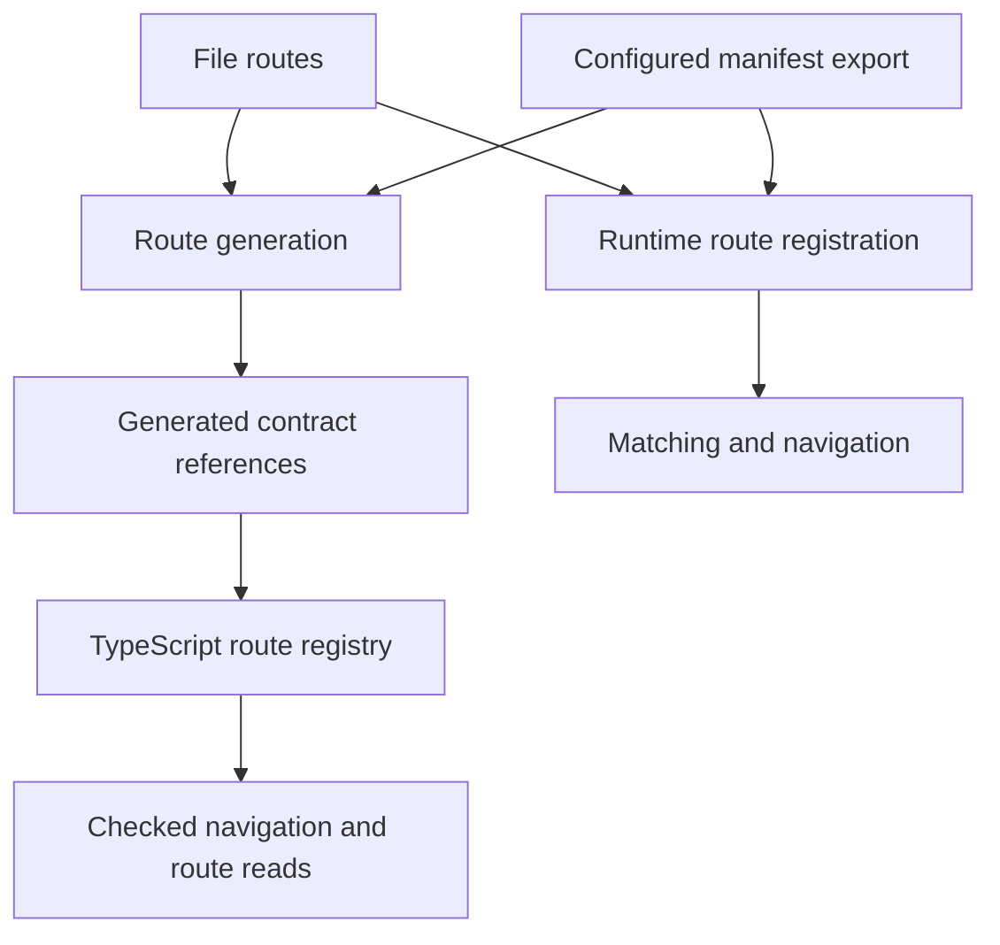

# Routing API for humans and coding agents

This plan describes a routing API whose contracts guide correct code from a
destination through loading, rendering, and returning. Readers should be able
to review the whole feature set first, then discuss each feature independently.
The implementation and migration sequence follows the feature sections.

## Feature overview

The table is the review map. “Extend” means there is an existing capability to
build on, not that the proposed surface already works. “Explore” marks a
capability whose cost or platform feasibility needs a separate decision.

| Feature                                                                                          | Direction                    | What a developer should be able to do                                                   |
| ------------------------------------------------------------------------------------------------ | ---------------------------- | --------------------------------------------------------------------------------------- |
| [1. Shared destination contract](#1-shared-destination-contract)                                 | Extend                       | Use the same typed destination with navigation, links, redirects, and URL generation.   |
| [2. Generated registration](#2-generated-registration)                                           | Agreed                       | Get file and programmatic route types without handwritten module augmentation.          |
| [3. Route authoring and inference](#3-route-authoring-and-inference)                             | Selected                       | Declare search, guards, loaders, and screens without duplicating their contracts.       |
| [4. Paths and route identity](#4-paths-and-route-identity)                                       | Extend                       | Address static, index, dynamic, optional, and catch-all routes consistently.            |
| [5. Platform availability](#5-platform-availability)                                             | Extend                       | Catch a destination that has no screen on the calling platform.                         |
| [6. Path parameters](#6-path-parameters)                                                         | Extend                       | Require the correct path fields and omit unnecessary empty objects.                     |
| [7. Search parameters](#7-search-parameters)                                                     | Add                          | Validate URL filters and infer their input and output types.                            |
| [8. Search updates](#8-search-updates)                                                           | Implemented                  | Change filters, preserve chosen fields, and control history growth.                     |
| [9. Navigation operations](#9-navigation-operations)                                             | Add facade                   | Push, replace, and navigate; select typed custom CSR transitions without SSR.           |
| [10. Results and cancellation](#10-results-and-cancellation)                                     | Extend                       | Await navigation and distinguish completion, refusal, failure, and supersession.        |
| [11. Pending navigation](#11-pending-navigation)                                                 | Add                          | Show loading feedback while the previous screen remains visible.                        |
| [12. Back and history](#12-back-and-history)                                                     | Extend                       | Return safely, provide a fallback, and understand stack boundaries.                     |
| [13. Screen props and route accessors](#13-screen-props-and-route-accessors)                     | Add                          | Read inferred params, search, data, and context without unsafe casts.                   |
| [14. Links and active matching](#14-links-and-active-matching)                                   | Extend                       | Preserve real browser links and choose what makes a link active.                        |
| [15. Navigation components](#15-navigation-components)                                           | Extend                       | Use typed destinations in tabs, sidebars, menus, and breadcrumbs.                       |
| [16. Layouts and route groups](#16-layouts-and-route-groups)                                     | Extend / explore             | Share layouts without accidentally creating navigation histories or guard inheritance.  |
| [17. Guards and redirects](#17-guards-and-redirects)                                             | Extend                       | Apply predictable checks and redirect through typed destinations.                       |
| [18. Authentication and return destinations](#18-authentication-and-return-destinations)         | Extend                       | Protect direct entry, return after login, and respond to account changes.               |
| [19. Typed context](#19-typed-context)                                                           | Add                          | Supply current application dependencies without mixing them into URL params.            |
| [20. Loaders and live data](#20-loaders-and-live-data)                                           | Extend                       | Infer loader inputs and output while keeping live queries in the data layer.            |
| [21. Errors and not-found routes](#21-errors-and-not-found-routes)                               | Extend                       | Handle loading failures, rendering failures, and missing content deliberately.          |
| [22. Retry, refresh, and mutations](#22-retry-refresh-and-mutations)                             | Add                          | Reload data or navigate after saving without pushing duplicate history.                 |
| [23. Baked data and Markdown](#23-baked-data-and-markdown)                                       | Extend                       | Keep build-time content out of runtime dependency graphs and infer its data.            |
| [24. Stacks, tabs, and scoped navigation](#24-stacks-tabs-and-scoped-navigation)                 | Extend                       | Navigate within the owning flow without passing `_stack` around.                        |
| [25. Route modals and temporary surfaces](#25-route-modals-and-temporary-surfaces)               | Extend                       | Open shareable modal destinations and distinguish them from transient UI.               |
| [26. Provider and screen ownership](#26-provider-and-screen-ownership)                           | Extend existing              | Preserve providers and local screen state using the existing owner machinery.           |
| [27. Blocking and OS navigation](#27-blocking-and-os-navigation)                                 | Explore                      | Handle unsaved work with honest per-platform interception capabilities.                 |
| [28. Incoming URLs and URL generation](#28-incoming-urls-and-url-generation)                     | Extend                       | Resolve browser URLs and native links through the same contracts.                       |
| [29. Scroll and focus](#29-scroll-and-focus)                                                     | Extend                       | Restore entry state and make navigation understandable to keyboard and assistive users. |
| [30. Dynamic route registration](#30-dynamic-route-registration)                                 | Extend                       | Add, replace, and remove route layers without stale HMR registrations.                  |
| [31. Runtime destinations](#31-runtime-destinations)                                             | Implemented                  | Validate destinations whose identity is unknown at compile time.                        |
| [32. Transient state and flow reset](#32-transient-state-and-flow-reset)                         | Reset agreed / state explore | Replace one entry or reset its owning flow; consider non-URL state separately.          |
| [33. Prefetching and lazy screens](#33-prefetching-and-lazy-screens)                             | Explore                      | Reduce navigation latency without introducing an accidental second data cache.          |
| [34. Router instances, windows, and server hosts](#34-router-instances-windows-and-server-hosts) | Early boundary / parallel    | Isolate requests and settle shared SSR boundaries while client routing advances.        |
| [35. Generation and diagnostics](#35-generation-and-diagnostics)                                 | Extend                       | Get deterministic artifacts and actionable machine-readable failures.                   |
| [36. Migration and agent usability](#36-migration-and-agent-usability)                           | Required                     | Adopt one canonical workflow through starters, declarations, docs, and checks.          |

## Agreed priorities and scope

**User direction, 2026-10-19:** this project is pre-alpha. Make a **hard cutover**
to the canonical client. Breaking changes are acceptable. Remove legacy
compatibility adapters, stores and fallback routing paths; migrate the helpers,
Tabs, platform controls, maintained consumers and documentation. Do not retain
a legacy mode, aliases with old input shapes, or a separate compatibility
harness. This supersedes earlier temporary-adapter recommendations in this plan.

**Familiarity and type safety are the main priorities.** Prefer familiar
operations, declarations, and behavior when they can provide equally strong
contracts. Introduce custom syntax only for a demonstrated typing or
cross-platform need. In particular, evaluate familiar named file exports before
requiring a new definition helper; prove the inference either way.

The following requirements and design directions are agreed. Agreement on the
direction does not establish implementation or platform qualification.

| Agreed direction                              | Consequence                                                                                                                                                                                        |
| --------------------------------------------- | -------------------------------------------------------------------------------------------------------------------------------------------------------------------------------------------------- |
| Generated registration for both route sources | Application authors never write `declare module`; file contracts are generated, programmatic contracts are inferred, and their registration glue is generated from configured exports.             |
| Navigation belongs to an owning flow          | Bind `useRouter()` and Back availability/actions to the rendering flow instead of guessing the globally active stack.                                                                              |
| One typed navigation request                  | Keep destination fields and navigation options in one object; use inferred route contracts rather than module-name strings and untyped data.                                                       |
| Presentation and animation are separate       | Modal/page presentation is independent of a transition such as fade.                                                                                                                               |
| Modals can own multi-screen flows             | Back moves through the modal's flow; dismiss closes the modal flow.                                                                                                                                |
| Replace and flow reset are distinct           | Replace changes the current entry; reset establishes a new base for the owning flow. Browser limitations must be explicit.                                                                         |
| Route contracts stay URL-aware and inferred   | Borrow NativeScript's navigation ownership and behavior without copying loose destination/context typing. Runtime-created paths still need validation.                                             |
| Navigation lifecycle events remain distinct   | Preparation, commit, transition completion, hiding/unloading, and disposal must not be treated as interchangeable events.                                                                          |
| CSR transitions are coordinated by the router | A typed transition name selects browser animation around the actual DOM commit; ordinary application code does not wrap navigation in View Transition calls. No SSR host or hydration is required. |

An SSR requirements investigation accompanies this plan. Bring
instance/request isolation, host-independent preparation, and hydration/HTTP
boundaries forward before deeply implementing either side. This is a sequencing
change, not a claim that an SSR host or upstream hydration already works. The
[SSR investigation task](goddard://task/04307a62-6ae2-44ff-86c5-34317e1c01a6)
has completed. Its renderer feasibility results and routing/host requirements
are reconciled below. Buffered rendering and jsdom hydration passed temporary
renderer probes; Xplat HTTP integration, production builds, account isolation,
and real-browser hydration remain unproven. No SSR host implementation is
authorized or established by those results.

Other names, signatures, defaults, and behavior below are recommendations or
open decisions. This plan does not approve every optional feature merely by
listing it. It also does not reserve decision-ledger numbers; allocate those in
Silo before recording implementation commitments in the ledger.

## Design vocabulary and reading the examples

A **destination** identifies content. A **navigation request** adds history,
presentation, and transition choices. A **route match** describes resolved
content. An internal **entry** owns history identity, loaded state, and screen
lifetime. Keeping these separate prevents application navigation from supplying
framework state.

```ts
// Proposed conceptual shapes; concrete generic definitions remain to be designed.
type ItemDestination = {
	to: '/items/:id'
	params: { id: string }
	search?: { tab?: 'details' | 'activity' }
	hash?: string
}

type ItemNavigation = ItemDestination & {
	stack?: 'root' | 'catalog'
	presentation?: 'push' | 'modal'
	transition?: TransitionName // Built-in presets plus inferred registered names.
	replace?: boolean
}
```

Unless a section says “Current,” snippets show **proposed interface sketches**.
They are TypeScript/TSX syntax, not runnable imports from today's package.
Helpers such as `loadItem`, `saveItem`, and `readSession` stand for application
code. Screen names and route contracts form an illustrative packing-list app.
Signature and declaration sketches may refer to types introduced elsewhere in
the plan. They require syntax validation; type and runtime qualification must
wait for implementation fixtures with real declarations.

The shared imports below establish intended ownership. Routing operations and
hooks belong in the routing subpath; presentation components belong at the UI
root. A bound hook and the global facade share contracts, but not necessarily
the same default navigation owner.

```tsx
// Proposed imports, not current exports.
import { NavLink, RouteOutlet } from '@octane-xplat/ui'
import { router, useRouter, getRouteApi } from '@octane-xplat/ui/routing'
```

## 1. Shared destination contract

**Recommendation.** Every operation that consumes a destination should check
the same route identity, path fields, and search input. A required ID must not
be accepted by a link but rejected by a redirect, or vice versa.

```tsx
const destination = {
	to: '/items/:id',
	params: { id: 'coat' },
	search: { tab: 'activity' },
} satisfies Destination

router.push(destination)
router.href(destination)
const link = <NavLink {...destination}>Open coat</NavLink>
```

Current `TypedRoute` checks registered names and params for pushes and links,
but inherits resolved loader/context fields from `Route`. The new destination
must exclude those fields, and `redirect` and URL generation must use its
contract too. Runtime match objects remain separate.

```ts
// Proposed compile-time failure: loaded state cannot be supplied as a destination.
const invalid = {
	to: '/items/:id',
	params: { id: 'coat' },
	loaderData: { title: 'Skip the real loader' },
} satisfies Destination
```

**Agreed:** keep one typed request object, following the useful shape of
NativeScript's navigation entry without copying its loose destination and
context types. The internal type composition is open; callers should not need
a second options argument or a destination factory for ordinary literals.

**Acceptance:** compile-time negative cases for invented paths, missing fields,
wrong values, extra fields, and internal-state inputs; equivalent checking for
every destination consumer; useful errors for unions and reusable helpers.

## 2. Generated registration

**Agreed.** Developers do not write module augmentation for either route source.
For file routes, generation derives paths and references declared behavior.
For programmatic routes, TypeScript infers contracts from the manifest; the
generator emits a type reference to its configured export.

```ts
// Proposed route configuration fragment: explicitly identify exports to register.
const routing = {
	directory: './src/app',
	manifests: [{ module: './src/guide-routes', export: 'guideRoutes' }],
}
```

The generated registration joins both sources. Its exact type names are open;
the important distinction is that generation emits glue while the compiler
infers programmatic contracts. The generator must not execute arbitrary route
modules to discover their types. Existing intentional build-time baking remains
a separate operation.

```ts
// Generated module fragment; RouteParams and RouteContracts are declared above.
// Application authors never write this block. The private symbol gives every
// generated catalog its own contribution, even within one TypeScript program.
declare const registration: unique symbol

declare module '@octane-xplat/ui' {
	interface AppRoutes {
		[registration]: RouteParams
	}
	interface AppRouteContracts {
		[registration]: RouteContracts
	}
}
```

Both sources feed compiler checking and runtime registration through distinct
paths. A type-only registration must never be mistaken for loading screens.
Generated `.contracts.ts` now contains local inferred types; reusable target
catalogs reference it without contributing to ambient registration. The
compatible `.types.ts` entry re-exports those types and installs application
registration, and generated client entries import it explicitly. Screens use
`.contracts` for their own input/props annotations to keep that dependency local.

```ts
// In a route file, keep self-contract inference independent of app registration.
import type { RouteLoaderArgs, RouteProps } from '../../routes.gen.contracts'
```

Generation must also separate reusable executable definitions from the default
client registration side effect. Server requests consume a catalog safely and
instantiate local state; importing that catalog cannot register routes into a
global client singleton. Manifest JSON remains descriptive and cannot substitute
for executable guards, loaders, and screen exports.

```ts
// Proposed generated entry-point separation, not current filenames/exports.
import { catalog } from './routes.gen.catalog' // Reusable definitions.
import './routes.gen.client' // Browser application bootstrap only.
```



**Discuss:** where manifest configuration lives, generated artifact names, and
how multiple application programs avoid contaminating each other's ambient
registry. Generated declarations must be included automatically by normal
`dev`, `build`, and `typecheck` workflows.

**Acceptance:** a new file route and a configured programmatic manifest both
produce typed navigation without handwritten augmentation; missing exports,
stale output, and conflicting contributions produce clear diagnostics; installed
consumers see the same types as workspace consumers. Type-only and server
catalog imports must exclude browser/native bootstrap side effects and
server-only/build-only dependencies from client output. Browser-compatible
screens are not assumed safe to import during server rendering.

## 3. Route authoring and inference

**Selected: named file exports and inferred programmatic definitions.** File
routes keep their implicit filename path. Export a screen plus named optional
`validateSearch`, `beforeLoad`, `loader`, `head` and `ErrorBoundary`. Import the
local generated callback/screen types; they infer from that module's behavior
without going through the ambient application registry. No file wrapper or
handwritten module augmentation is required.

```tsx
// app/items/[id].tsx
import type { RouteLoaderArgs, RouteProps } from '../../routes.gen.contracts'
export function loader({ params }: RouteLoaderArgs<'/items/:id'>) {
    return { title: params.id }
}
export default function Item(props: RouteProps<'/items/:id'>) {
    return null
}
```

Programmatic routes use `defineRoute(options).screen(component)`: preparation
infers callback inputs, guard-added context and awaited loader output first;
screen checking then uses that fixed contract. `defineRoutes` assembles finished
definitions. The flat screen option is removed in this pre-alpha cutover.
Configured manifest exports receive the same generated application registration
as files. Keep the definition's local inference independent of its own
`getRouteApi` result; full destination checking belongs at catalog assembly.

```ts
import { defineRoute, defineRoutes } from '@octane-xplat/ui/routing/core'
const item = defineRoute({
    path: '/items/:id',
    loader: async ({ params }) => ({ title: params.id }),
}).screen(({ data }) => {
        const title: string = data.title
        return null
    })
export const routes = defineRoutes([item])
```

**Evidence and tradeoff.** Maintained TSX, TSRX, generated-local and package
consumer fixtures exercise the inference boundary, including compatible
platform variants and negative data/search checks. The large-catalog benchmark
checks 1,024 mixed file/programmatic routes through the actual generator and
package export map. File callbacks repeat their public path in a local type
annotation; this modest cost preserves familiar named exports and avoids a
self-referential initializer or a required file authoring wrapper. Source
parsing reserves named behavior exports so validators cannot become screens.

**Acceptance:** positive and negative declaration fixtures; plain TSX and TSRX;
file and programmatic parity; type-only references do not execute modules or
ship build-only imports; a representative large table has acceptable compiler
performance.

**Selected inference boundary (decision #120).** A single options object coupled
screen parameters to unfinished inference and needed permissive fallbacks.
Separating `.screen` removes that cycle while keeping named components and the
existing preparation field names. An unfinished builder cannot enter a catalog;
loader-free data stays undefined. Guard output must resolve to context or void,
and empty search has no invented fields. Maintained negative fixtures check
whole search/data values as well as individual fields, named screen mismatches,
missing guards, and async boolean guard returns.

TypeScript still infers dependent inline callbacks in order. Declare the
validator before guards and loaders, or use a named parser value when arranging
fields differently. Earlier inputs remain conservative; they must not silently
become `any` or `never`. Workspace and extracted-package fixtures establish this boundary under web,
native, macOS, Linux and Windows type conditions. Generated contract checks and
1,024-route compiler/editor checks pass for the same targets. Runtime host
qualification remains separate from TypeScript evidence.

**Universal compiler boundary.** The installed patched Octane 0.11.0 compiler
accepts module-level screen functions/arrows but rejects JSX callbacks inside
`.screen` and nested component declarations inside factories. Keep portable
JSX screens at module scope and derive their props from the preparation builder.
This does not weaken the inferred callback types; it is a separate native
code-generation limit. See the [source and build evidence](../docs/notes/routing-contracts.md#universal-compiler-component-placement).

```tsx
import { Text } from '@octane-xplat/ui'
import { defineRoute, type RouteScreenProps } from '@octane-xplat/ui/routing/core'
const item = defineRoute({ path: '/items/:id', loader: ({ params }) => params.id })
function Item(props: RouteScreenProps<typeof item>) { return <Text>{props.data}</Text> }
const route = item.screen(Item)
```

## 4. Paths and route identity

**Recommendation.** Keep bracket notation in route files and use absolute,
URL-shaped patterns in public code. Index routes normalize to their containing
path. This changes current route identifiers, which generally omit the leading
slash and use `index` for the root.

```text
app/index.tsrx                 -> /
app/settings.tsrx              -> /settings
app/items/index.tsrx           -> /items
app/items/[id].tsrx            -> /items/:id
app/[[locale]]/help.tsrx       -> /:locale?/help
app/docs/[...rest].tsrx        -> /docs/*rest
```

One normalization grammar must govern generation, runtime matching, inferred
types, URL building, and manifest JSON. Catch-all scope matters: a root catch-all
can conflict with named-stack URL interpretation. Layout directories also use
normalized pattern prefixes rather than concrete param values.

```ts
router.push({ to: '/docs/*rest', params: { rest: 'packing/winter' } })
router.push({ to: '/:locale?/help', params: { locale: 'en' } })
```

**Discuss:** case sensitivity, trailing slash policy, encoded separators,
anonymous splats, and relative destinations. Recommend starting with absolute
destinations; add relative navigation only with an explicit origin and tests.

**Acceptance:** root/index round trips; static versus dynamic precedence;
optional and catch-all behavior; Unicode and encoded input; diagnostics for
ambiguous patterns; type/runtime/CLI conformance fixtures.

**Reported baseline to change deliberately:** the isolated matching probe
returned no route for `/` despite index metadata and returned a legacy literal
route for an unknown `/missing` path. Establish strict external matching and
separate unknown pattern, malformed input, and unavailable screen outcomes.
Remove legacy unknown-path fallbacks; all client entry paths use strict matching.

```text
Proposed conformance fixtures:
/                 + declared index -> index match
/missing          + no pattern     -> not-found
/items/%ZZ        + malformed URI  -> invalid-input
known destination + no target leaf -> unavailable
```

## 5. Platform availability

**Selected and implemented direction.** Keep the familiar default client shared
across targets. Its static destinations require screens in every generated
catalog. A platform-only screen needs the existing `validateDestination` proof,
or an explicit instance inferred from an actual target catalog. Framework
exports stay identical; callers do not handwrite registration or assert types.

```ts
import { router } from '@octane-xplat/ui/routing'
const camera = await router.validateDestination({ to: '/camera' })
if (camera.status === 'valid') await router.push(camera.destination)
```

**Variant contracts.** Every screen variant must agree on params, search input
and validated output, context and loader-data shape. Generated checks compare
each leaf in both directions and identify the route/source pair. Callback
helpers can be shared while screen markup differs. Discovery accepts the same
`.tsx`, `.tsrx` and `.md` screen formats as runtime loading; ordinary `.ts`/`.js`
helpers cannot advertise phantom routes. Renaming the parameter of the same URL
shape across variants is an explicit generation error.

```text
app/settings.tsrx        shared destination
app/camera.web.tsrx      web + Linux WebKit; shared calls need proof
app/profile.ios.tsrx     must agree with profile's other leaf contracts
app/profile.android.tsrx same params/search/context/data shape
```

**Availability and execution are separate.** Target catalogs infer only their
available paths. Missing screen patterns remain as pure metadata, so incoming
URLs distinguish `not-found/unavailable` from `not-found/pattern` without
importing another platform's executable screen. JSON metadata reports available
targets. `.mobile` covers iOS, Android and generic mobile; Linux permits `.web`
fallback. Configured programmatic declarations retain their declared contract.
Screen availability does not promise host readiness or authorization.

```ts
import { routes } from './routes.gen.catalog.web'
import { createRouter } from '@octane-xplat/ui/routing/core'
import type { RouterHost } from '@octane-xplat/ui/routing/core'
export function createWebNavigation(host: RouterHost) {
    return createRouter({ catalog: routes, host })
}
```

**Correctness evidence.** The original guard-ordering probe demonstrated falsely
typed web loader data and unchecked shared navigation to a web-only screen.
Maintained consumer tests now reject incompatible data/search/context variants,
check the default hook, links, href and redirects, and execute every generated
target catalog's availability resolution. These are compiler and host-free
runtime checks; they do not establish device rendering or Windows execution.

**Acceptance:** shared calls cannot silently reach absent screens; variants
with incompatible params/search/data are diagnosed; runtime availability is
honest about registered screens and host readiness being different facts.

## 6. Path parameters

**Recommendation.** Path fields are string inputs by default. Required segments
require values; all-optional destinations can omit `params`; static routes do
not accept an arbitrary record merely because their generated type is `{}`.

```ts
router.push({ to: '/settings' })
router.push({ to: '/items/:id', params: { id: 'coat' } })
router.push({ to: '/:locale?/help' })

// Expected type errors in implementation fixtures:
router.push({ to: '/items/:id' })
router.push({ to: '/settings', params: { invented: true } })
```

**Discuss:** opt-in parsed path values, duplicate param names across nested
segments, and splat representation. Keep the first version explicit rather
than coercing arbitrary numbers and objects differently across platforms.

**Acceptance:** optionality and excess-property checks at normal literal call
sites; no claim that TypeScript provides universal exact-object checking for
all structural values; runtime validation for external and dynamic inputs.

## 7. Search parameters

**Recommendation.** Give URL search its own declared validator and serializer.
Distinguish input accepted by navigation from validated output read by loaders
and screens. Defaults belong to the route contract; external input is checked
even if all internal callers typecheck.

```ts
// Proposed validator example; raw input is untrusted.
function validateSearch(raw: Record<string, unknown>) {
	const pageText = raw.page
	const page = pageText === undefined ? 1 : Number(pageText)
	if (!Number.isInteger(page) || page < 1) throw new Error('Invalid page')
	const tab = raw.tab ?? 'details'
	if (tab !== 'details' && tab !== 'activity') throw new Error('Invalid tab')
	return { page, tab }
}

router.push({ to: '/items', search: { page: 2 } })
```

**Discuss:** plain validators versus a compatible existing schema interface;
how validators declare navigation input separately from parsed output;
repeated query keys; arrays; unknown fields; null/empty/absent values; canonical
omission of defaults. A callback accepting `Record<string, unknown>` does not
by itself infer a strict navigation input type. Solve that explicitly.

**Acceptance:** input/output type fixtures; invalid values fail predictably;
defaults and serialization round-trip; no new dependencies or peers in `ui`;
no collision between path fields and search fields of the same name.

**Implemented protocol rule.** Standard Schema v1 search validators use their
`~standard.validate` result even when the schema itself is callable. This
matches type-level input/output inference. Sync/async protocol failures prevent
guards and loaders in both file and programmatic routes; ordinary parsers
continue to use their function body. Both authoring paths require object
protocol output; a callable's separate object return cannot conceal a scalar
schema result.

**Named output interfaces.** File and programmatic validators now accept ordinary
TypeScript interfaces as output, including async parsers and Standard Schema.
The constraint describes a field object without requiring a string index
signature. Scalar, array, Date, collection and callable roots remain invalid;
runtime preparation checks JavaScript outputs before guards/loaders. Return
plain field objects (or null-prototype bags), rather than class instances.

```ts
interface ItemSearch { page: number }
function validateSearch(raw: { page?: unknown }): ItemSearch {
	return { page: Number(raw.page ?? 1) }
}
```

The matching probe reported last-value wins for repeated query keys, literal
`+` rather than form-style space decoding, and a null result for malformed
encoding. These are observations, not the chosen future policy. Pin repeated
key, plus/space, malformed input, and default/canonicalization cases before
changing the codec; invalid external input must not become an undifferentiated
missing route or generic server failure.

```text
?tab=details&tab=activity -> explicit repeated-key policy
?query=a+b               -> explicit plus/space policy
?query=%ZZ               -> invalid-input classification
```

## 8. Search updates

**Implemented decision.** Search edits use the owning route's contract.
`getRouteApi(path, instance?).useUpdateSearch()` binds a callback to its
rendering entry. The callback receives validated search output and returns
the entire navigation search input, preserving the input/output distinction.
It defaults to replacement; `replace:false` pushes. Omitted fields are removed
and defaults apply again. Keep fields explicitly in the callback.

```tsx
const items = getRouteApi('/items')
function ItemFilters() {
	const updateSearch = items.useUpdateSearch()
	return <Button label="Next page" clickAction={() => {
		void updateSearch(previous => ({ ...previous, page: previous.page + 1 }))
	}} />
}
```

The updater cannot edit an inactive entry or a later record using the same
pattern. A stale callback returns `cancelled` before running application code.
Guards and loaders rerun through ordinary navigation; no prepared-data shortcut
is introduced. Params, fragment and owning flow remain attached to the entry.
Edits use no animation and ordinary host scroll rules: web restores a matching
fragment or starts at the top; Back restores the previous entry's saved position.
The callback must be synchronous and pure; unrelated-route preservation and
pagination reset stay explicit application policy.

**Acceptance:** replace does not grow history; push does; removing a field
uses a specified representation; stale callbacks cannot edit another active
route; loader dependencies and scroll behavior are explicit.

## 9. Navigation operations

**Recommendation.** Provide `navigate`, `push`, and `replace` with the same
destination contract. `navigate` pushes by default and accepts `replace: true`;
the explicit methods express a chosen history action. Do not add undocumented
deduplication or “pop to an existing screen” semantics.

```ts
await router.push({ to: '/items/:id', params: { id: 'coat' } })
await router.replace({ to: '/login' })
await router.navigate({ to: '/settings', replace: true })
```

Replacement needs a real implementation for root stacks, named stacks, and
supported modal cases. The initial entry, native page disposal, browser entry
IDs, and retained scroll state all need defined behavior. Current routing has
no public replacement operation.

```text
Before: Home -> Item A
push B: Home -> Item A -> Item B
replace B: Home -> Item B
Back after replacement: Home
```

**Agreed:** use one typed request object and keep history action, presentation,
and transition independent. A modal can fade in without making fade a third
presentation mode. Transition names and supported overrides remain to be
qualified; the sketches show only illustrative shared values.

```ts
router.push({
	to: '/items/:id/edit',
	params: { id: 'coat' },
	presentation: 'modal',
	transition: 'fade',
})
```

**Discuss:** repeated same-URL pushes; replace during transitions; behavior
when no current entry exists; reduced-motion policy; supported transition
names, durations, and platform subsets. Decide whether `navigate` adds useful
familiarity beyond explicit push/replace methods before keeping all aliases.

**Agreed CSR direction.** Use same-document View Transitions as an optional
browser backend for named transition presets and custom effects. Prepare guards and
required data first, then wrap the route's DOM commit. Prove Octane's renderer
completion boundary so a router-state notification cannot be mistaken for a
finished DOM update. No common-case browser-specific boolean is needed.

```ts
// Proposed application request; browser engine selection stays in the adapter.
await router.push({
	to: '/items/:id',
	params: { id: 'coat' },
	transition: 'fade',
})
```

**Web acceptance:** unavailable or skipped animation does not fail a successful
route commit; reduced motion has a documented policy; commit and animation
completion remain separate. Skipping a browser transition does not cancel its
update callback, so stale-request checks must also run at the deferred commit.
Cover overlap, Back/Forward, modal backgrounds, and scroll/focus. Shared-element
effects and cross-document transitions remain separate scope until qualified.

**Acceptance:** identical validation across methods; specified Back behavior;
replacement releases old ownership without discarding unrelated entries;
animation cannot change history meaning; migrate the current presentation
`fade` value and `+fade` file defaults into transition metadata; platform
limitations are proven and explicit.

### Custom CSR transitions

Applications request a typed transition name at navigation. The registry
supplies its target-specific implementation. This is ordinary client-side
routing: the browser prepares data and renders the destination without an SSR
host, server-rendered initial HTML, or hydration. `defineTransitions` and
`defineWebTransition` are now exported and qualified in production Chromium.
The NativeScript Frame helper and incoming AppKit pane executor are implemented.
Native modal surfaces and native GTK executors remain outside those supported
subsets. Explicit skipped leaves are available for targets without an executor.

```ts
// Proposed shared screen code.
const navigation = useRouter()
await navigation.push({
	to: '/items/:id',
	params: { id: 'coat' },
	transition: 'item-detail',
})
```

Register transition implementations once and reference that export from app
configuration. Infer allowed names from its keys and generate their registration
alongside route contracts; authors do not maintain another name union or write
augmentation. Built-in presets remain available without custom registration.

```ts
// Proposed transitions.ts.
import { defineTransitions } from '@octane-xplat/ui/routing'
import { itemDetailTransition } from './item-detail'

export const transitions = defineTransitions({
	'item-detail': itemDetailTransition,
})
```

```ts
// Proposed app configuration fragment; exact enclosing configuration is open.
const routing = {
	transitions: { module: './src/transitions', export: 'transitions' },
}
```

The web leaf declares its motion/fallback policy and chooses browser transition
types for forward and Back movement. CSS supplies the visual effect. The adapter
owns snapshot timing, the actual route commit, renderer flushing, interruption,
and completion; application callbacks do not decide when to commit a route.

```ts
// Proposed item-detail.web.ts.
import { defineWebTransition } from '@octane-xplat/ui/web'

export const itemDetailTransition = defineWebTransition({
	reducedMotion: 'skip',
	unsupported: 'skip',
	types: ({ direction }) => [direction === 'back' ? 'item-detail-back' : 'item-detail-forward'],
})
```

```css
/* Illustrative browser CSS: direction-specific entry motion. */
html:active-view-transition-type(item-detail-forward)::view-transition-new(root) {
	animation: item-detail-forward 240ms ease-out both;
}

html:active-view-transition-type(item-detail-back)::view-transition-new(root) {
	animation: item-detail-back 240ms ease-out both;
}

@keyframes item-detail-forward {
	from {
		opacity: 0;
		transform: translateX(16px);
	}
	to {
		opacity: 1;
		transform: translateX(0);
	}
}

@keyframes item-detail-back {
	from {
		opacity: 0;
		transform: translateX(-16px);
	}
	to {
		opacity: 1;
		transform: translateX(0);
	}
}
```

The same shared name can resolve to native platform leaves. A NativeScript leaf
can adapt a custom native transition instance; other native hosts require their
own implementations. Platform helpers must return an identical public
`TransitionDefinition` contract. Missing target implementations need a clear
diagnostic or explicitly declared fallback, never implied native visual parity.

```text
transitions.ts                  -> registers 'item-detail'
item-detail.web.ts              -> browser View Transition definition and CSS
item-detail.mobile.ts           -> NativeScript iOS/Android adapter
item-detail.macos.ts            -> separate macOS host adapter, if supported
```

The AppKit leaf now has a typed incoming-pane helper. It reuses the existing UI
numeric controller, animates a router-owned wrapper back to neutral values and
restores it on interruption/disposal. The linear duration uses milliseconds;
translations use layout units and rotation degrees. The departing entry supplies
the definition for Back, with the callback receiving its reverse direction.
The same coordinator animates routed AppKit modal content after the surface
appears; native GTK and Windows remain explicit unsupported subsets.

```ts
// item-detail.macos.ts — implemented helper, incoming view only.
import { defineAppKitTransition } from '@octane-xplat/ui/macos'
export const itemDetailTransition = defineAppKitTransition({
	from: ({ direction }) => ({ opacity: 0.2, translateX: direction === 'back' ? -24 : 24 }),
	duration: 240,
})
```

For CSR, the router waits for guards and required loaders before taking the old
snapshot, then commits and flushes the new screen inside the browser update
callback. Ordinary application code must not wrap its navigation call in
`document.startViewTransition`: that would put preparation and commit timing
outside the router's coordination. A cold CSR visit can render the initial
screen without inventing a previous-route animation.

```text
Validate destination -> guards/loaders -> verify request is current
-> capture old screen -> commit and flush DOM -> animate
```

Navigation and animation have independent outcomes. Awaiting navigation reports
commit, refusal, cancellation, or failure. A skipped/failed visual effect does
not retroactively fail a successful commit. If a transition-finished API is
needed, expose it separately rather than delaying every navigation promise.

```ts
const result = await navigation.push({
	to: '/items/:id',
	params: { id: 'coat' },
	transition: 'item-detail',
})
if (result.status === 'committed') announceDestination()
```

**Discuss:** final helper/configuration names; shared transition definition
types; cancellation/disposal callbacks; full direction variants for replace,
reset, modal open, and dismissal; custom parameters and their inference; default
and per-call overrides; capability detection for transition types as well as
the base browser API. The current direction sketch demonstrates push/Back only.

**Acceptance:** infer registered keys and reject misspelled names at compile
time; reject duplicate registrations; generate registration without executing
animation modules; diagnose unavailable target implementations. Prove Octane's
DOM-flush boundary before finalizing adapters. Test unsupported API/type support,
reduced motion, animation failure, interrupted navigation, stale deferred update
callbacks, Back/Forward, modal backgrounds, and scroll/focus. A CSR-only fixture
must work without an SSR host or hydration path; real-browser qualification
must remain separate from mock callback tests. No new dependencies or peers in
`ui` and no browser DOM runtime imports in shared/native modules.

## 10. Results and cancellation

**Recommendation.** Navigation returns a promise with a discriminated result.
Completion means the destination was committed to the navigation model and
host, not that every visual transition or subsequent query has finished.
Expected non-success outcomes settle the promise rather than disappearing into
a console warning.

```ts
type NavigationResult =
	| { status: 'committed'; route: RouteMatch; redirected: boolean }
	| { status: 'cancelled'; reason: 'superseded' | 'owner-disposed' | 'aborted' }
	| { status: 'blocked' }
	| { status: 'not-found'; destination: unknown }
	| { status: 'failed'; diagnostic: RouteDiagnostic }

const result = await router.push({ to: '/settings' })
if (result.status === 'failed') reportNavigationProblem(result.diagnostic)
```

Build on current request-version tracking. A redirect retains request identity;
claiming another stack cannot revive stale work. Cancellation should reach
guard/loader work where supported, while stale-result checks remain necessary
for work that does not cooperate.

Hosts explicitly claim the commit immediately before changing history or a
Frame. Once accepted, a newer navigation does not turn that committed operation
into a superseded result. Disposal and external traversal can still cancel
remaining work. Keep accepted operations tracked until their commit promise
settles, including when another request replaces their pending slot.

```ts
// Proposed callback input; verify the cancellation primitive on every runtime.
async function loader({ params, signal }: ItemLoaderArgs) {
	return loadItem(params.id, { signal })
}
```

**Discuss:** which unexpected programming errors reject instead of returning
`failed`; transition completion as a separate optional signal; cancellation
primitive availability without DOM runtime dependencies; cancellation after
commit; how loader-error UI affects the navigation result.

**Agreed lifecycle distinction.** NativeScript's separate navigation and Page
lifecycle events are useful implementation guidance. The adapter must map those
events deliberately rather than using an unload event as proof of disposal or
a navigation-start event as proof of completion. Retained hidden screens and
their owners still exist.

| Milestone            | What it means for this design                                                                        |
| -------------------- | ---------------------------------------------------------------------------------------------------- |
| Prepared             | Inputs, guards, and required loading permit a commit; the request can still be superseded.           |
| Committed            | Navigation state and the target host accept the destination; this is the recommended await boundary. |
| Transition completed | Visual movement finishes; it is distinct from commit and may be disabled or interrupted.             |
| Hidden/unloaded      | Content leaves active display; retained entry state and ownership may remain.                        |
| Disposed             | The entry releases owned rendering and resources; it cannot be revived by stale work.                |

**Acceptance:** every branch settles exactly once; missing screens/hosts,
redirect loops, disposal, Back, overlap, and thrown guards have explicit results;
underlying side effects are never claimed to have been rolled back.

## 11. Pending navigation

**Recommendation.** Expose navigation state separately from committed screen
data. Applications can show feedback while guards or loaders run without
inventing local promises for each button.

```tsx
function NavigationStatus() {
	const navigation = useNavigation()
	return navigation.status === 'pending' ? <Text>Opening screen…</Text> : null
}
```

**Implemented decision:** expose `useNavigation()` and
`useRouterState().navigation` as a single `idle` / `pending` / `failed` union
for the rendering flow. Pending and failed variants carry the attempted action
and a readonly URL-input snapshot; only failure carries its structured result.
Back/dismiss can be pending without a destination. This replaces the nullable
`RouterState.pending` field without a compatibility alias. Shared status UI may
inherit a custom provider because it exposes no route DTO; typed route-data
readers still require the custom instance explicitly. Delays and minimum display
durations remain presentation concerns, not router timers.

Failure feedback retains the previous committed screen and URL. It remains
available for retry, is hidden while another attempt is pending, and clears on
successful commit, explicit `clearFailure()`, external history traversal or
owner disposal. Cancellation does not create an error. Retry uses captured
inputs and rechecks current guards and definitions; clearing feedback also
forgets that retry target without cancelling new work.

**Acceptance:** only current requests appear pending; cleanup clears state;
no unnecessary history entry for pending UI; startup and push behavior have
documented screen visibility and provider ownership.

## 12. Back and history

**Agreed:** Back availability and Back actions belong to their navigation
owner, following NativeScript's Frame model. Keep a reactive availability hook.
**Recommendation:** add an explicit fallback for direct-entry screens. On web,
unrelated browser history must not be treated as guaranteed application history.

```tsx
function BackButton() {
	const navigation = useRouter()
	const canBack = useCanGoBack()
	return (
		<Button clickAction={() => navigation.back({ fallback: { to: '/items' } })}>
			{canBack ? 'Back' : 'Items'}
		</Button>
	)
}
```

Current web Back accepts a stack argument but operates on one browser history.
The future contract must not imply that it can independently remove an inactive
tab's entry. Browser Forward and native “forward” are also different features.

```text
Browser: one chronological history, with entries selecting conceptual outlets.
Native: root/modal history plus independently owned named flows.
```

**Discuss:** fallback replacement versus push; Back during pending navigation;
multi-entry back; explicit browser-forward support; returning to a specific
ancestor without guessing history depth.

**Acceptance:** base entries, direct links, modal dismissal, and concurrent
loads behave predictably; native and browser differences are explicit in the
API or capabilities, not silently ignored arguments.

## 13. Screen props and route accessors

**Recommendation.** Offer generated screen props and route-specific hooks.
Props make a screen's inputs visible; scoped hooks serve children without prop
threading. General route inspection remains a match union, not a caller-chosen
generic assertion.

```tsx
import type { RouteProps } from '../routes.gen.types'

function ItemScreen(props: RouteProps<'/items/:id'>) {
	return <Text>{props.data.title}</Text>
}

const itemRoute = getRouteApi('/items/:id')
function ItemHeading() {
	const params = itemRoute.useParams()
	const data = itemRoute.useLoaderData()
	return <Text>{`${params.id}: ${data.title}`}</Text>
}
```

**Discuss:** required matched-route context; inactive retained screens; behavior
outside a match; typed error/pending states; server snapshots. A route-specific
hook should bind to the rendering match, so a hidden Item A cannot begin reading
Item B just because the global destination changed.

**Acceptance:** no manual loader-data duplication; no unsafe narrowing by
generic argument alone; reactive reads on native unchanged-prop children;
screen-specific subscriptions and retained state; useful error outside scope.

**Implementation refinement:** aggregate reads/results can contain runtime
registrations. Their declared branch keeps the inferred union behind
`contract: 'declared'`; runtime data stays unknown. Named route accessors provide
precise inferred data after checking owner, path and declared-contract evidence.
This supersedes aggregate-union sketches that assumed every match was declared.

```ts
const item = getRouteApi('/items/:id', navigation)
const data = item.useLoaderData() // inferred inside the matching screen
```

## 14. Links and active matching

**Recommendation.** Keep real anchors on web, preserve modified clicks, and
expose destination props directly. Active matching should state whether it
matches only the exact route, descendants, and chosen search fields.

```tsx
const links = (
	<>
		<NavLink to="/items" match="prefix" activeClassName="selected">
			Items
		</NavLink>
		<NavLink to="/items/:id" params={{ id: 'coat' }} target="_blank">
			Coat
		</NavLink>
		<Link href="https://example.com/help">External help</Link>
	</>
)
```

**Discuss:** active matching spelling, trailing slashes, search/hash sensitivity,
external/internal input exclusivity, anchor `rel` and `download`, disabled
semantics, and supported non-web behavior. Set accessible current-page state
only where the selected matching behavior warrants it.

**Acceptance:** context menus and modified clicks retain browser behavior;
prevented activation does not navigate; no conflicting interactive roles;
typed destinations never become manually concatenated strings in examples.

## 15. Navigation components

**Recommendation.** Carry destinations into composed navigation components.
Developers should not lose type checking merely because a link is rendered as
a sidebar item, breadcrumb, top navigation item, or navigation tab.

```tsx
const navigation = (
	<SideNav>
		<SideNavItem label="Items" to="/items" />
		<SideNavItem label="Coat" to="/items/:id" params={{ id: 'coat' }} />
		<SideNavItem label="Help" href="https://example.com/help" />
	</SideNav>
)
```

**Implemented decision:** keep the familiar destination fields directly on
items, including readonly data arrays and nested menu links. `to` checks the
catalog, path params, search, stack and transition names; `href` remains a raw
URL alternative and fieldless entries remain actions. The same components
accept an opaque checked destination as their whole `to` value. Literal names
under an explicit instance provider require `router={instance}`; opaque values
may inherit their issuing instance because activation rechecks its identity.

The covered surfaces are `SideNavItem`, `TopNavItem`, `TopNavMenu` data,
`TopNavMegaMenuItem`, `NavHeadingMenuItem`, `NavigationMenu` data, navigation
`Tab`, `Breadcrumbs` including overflow, and compound/data `DropdownMenu` and
`ContextMenu` links. Top-bar menu rows share the menu keyboard controller.
Active state follows the owning flow, disabled items cannot activate, and a
cancellable selection callback can prevent navigation and menu closing.
Browser links preserve hrefs, modifiers, targets and download behavior.

A navigation `Tab` still needs its stable `value`; its route determines active
styling. `role="tablist"` controls local panels, rejects typed `to`, and keeps
the documented ignored-`href` behavior. `TabMenu` remains local selection;
routing overflow composes the existing `DropdownMenu` link parts. A visual tab
is not automatically a stack. `NoInfer` must cover both the catalog and its key
argument so readonly arrays do not infer partial catalogs from route strings.

**Acceptance:** internal and external destinations are unambiguous; no new
invented wrapper conventions; active and disabled behavior remains accessible;
ordinary data arrays retain literal inference.

## 16. Layouts and route groups

**Recommendation.** Preserve directory layouts, index screens, and nested
patterns. Explain layout nesting, URL nesting, and stack creation as different
operations. Pathless groups and inherited guards need an explicit design if
included; existing layouts do not establish a complete parent-route lifecycle.

```tsx
// Current layout model, retained by the proposal.
function ItemsLayout(props: { children?: unknown }) {
	return (
		<View>
			<Text>Items</Text>
			<>{props.children}</>
		</View>
	)
}
```

**Discuss:** preserving layout state when sibling routes change; param access
in ancestor layouts; pathless `(group)` directories; parent pending/error UI;
parent-before-child guard order; when parent loaders rerun. Do not promise all
of these merely by borrowing a familiar filename convention.

**Acceptance:** layout identity and remount behavior are documented; route
prefix matching is consistent for dynamic/optional ancestors; any inherited
lifecycle has deterministic order, data/context flow, and cancellation.

## 17. Guards and redirects

**Recommendation.** Use typed destinations for redirects and prepare routes
consistently across pushes, replacements, direct URLs, native links, and
history restoration. Guard denial must not expose the protected screen first.

```ts
function beforeLoad({ context }: GuardArgs) {
	if (!context.account) redirect({ to: '/login' })
	return { accountId: context.account.id }
}
```

The canonical client has typed redirects and common preparation for pushes,
bootstrap and links. The web host now also prepares retained history targets
inside the same attempt, with fresh guards/loaders and one root-context snapshot
across restored background/modal entries. Native retained-history integration
remains in progress.

```ts
redirect({ to: '/login', stack: 'root' })
```

**Discuss:** guard return versus thrown redirect; explicit blocked results;
parent composition; replace semantics for redirects; restoration after denial;
guard rechecks versus retained loader results. Browser popstate has already
moved history, so refusal needs a proven correction strategy without loops.

**Acceptance:** redirect chains preserve request identity; loops return useful
diagnostics; stale guards cannot commit; checks cover direct entry without
claiming client guards replace server access controls.

## 18. Authentication and return destinations

**Recommendation.** Authentication is application policy built with router
context and guards. Returning after login validates the requested application
destination, then replaces the login entry instead of pushing it into the
return path.

```ts
async function finishLogin(returnUrl: string) {
	// The application updates its session source before this call.
	return router.navigateUrl(returnUrl, { replace: true })
}
```

Use the configured origin/scheme policy for URL text, then run current guards
and loaders. Invalid or missing return locations produce explicit results and
leave the committed login screen intact; the application can choose a typed
home fallback. A resolver's raw destination is not a compile-time contract proof.
Retained matches keep prepared context until refresh or owner replacement.
Authority changes should replace a common keyed owner around every affected
outlet, not merely mutate a context object. Browser URLs survive that boundary; the web host prepares those older URLs
against the new context rather than restoring the discarded DTO.

**Owner handoff, qualified in browsers and native hosts.** Updating an account and
starting the return from the retiring outlet can cancel that request. Pass the
return URL into a one-shot continuation in the replacement tree and wait for
its mount and startup work to settle. The
[guide](../../docs/app/navigation.md#return-after-sign-in) shows this without
another router API or a second auth framework. A shared maintained example has
four DOM/jsdom tests and 20 production-browser checks for cold/warm links,
account-switch/expiry Back and Forward, sign-in expiry/retry, late SDK results
after modal cancellation, modal success, owner handoff, invalid returns and
cleanup. The browser fixture uses an explicit host instance with controlled SDK
promises. A renderer-neutral controlled example also runs on actual iOS and
Android Frame/modal hosts and AppKit retained views/panels. It verifies expiry,
modal cancellation/success, replacement-owner returns, private-view release and
pending loader cancellation, including a loader that ignores its abort signal.
The native protocol has 18 assertions, plus host-settlement waits; its object
driver regression and the full native driver suite pass. The complete release
fixtures pass 267 iOS, 264 Android and 243 AppKit checks. These are explicit URL
requests inside running native applications, not OS-delivered cold-auth links or
identity-provider exchanges. Real provider cancellation remains unqualified;
credentials and application-store cleanup remain application-owned.

**Discuss:** accepted origins/schemes for return URLs; context changes while
entries are retained; rechecking current routes after logout; removing sensitive
loaded state; when login/logout should reset its owning flow. A compile-time
route union cannot validate a URL received from a query string.

**Acceptance:** cold links, warm links, browser restoration, modal routes,
cancelled login, and expired accounts have explicit outcomes; no automatic
application-owned data deletion; server authorization remains separate.

## 19. Typed context

**Recommendation.** Supply application dependencies through a typed source read
when preparing a navigation. Keep that source separate from params and search,
and distinguish its values from context produced by guards.

```ts
// Proposed configuration fragment; router-instance placement is still open.
const context = () => ({
	account: readSession().account,
	services: applicationServices,
})
```

**Discuss:** how root context is declared and inferred; application/window
scope; parent-to-child guard additions; when retained matches refresh; context
snapshots versus live provider values. Do not expose framework-prepared context
as arbitrary destination input.

**Acceptance:** no flattened name collisions between context, params, and
loader data; account changes do not remain captured forever; typed context
works across redirects and existing native ownership boundaries.

## 20. Loaders and live data

**Recommendation.** Loaders receive validated inputs, typed context, and
cancellation. Their awaited output types flow to screens. Live queries and
subscriptions remain in the existing data layer rather than becoming an
implicit router cache.

```ts
async function loader({ params, search, context, signal }: ItemLoaderArgs) {
	return context.services.items.load({
		id: params.id,
		tab: search.tab,
		signal,
	})
}
```

**Discuss:** push-before-mount versus standard pending UI; parallel loaders;
parent loader dependencies; reloading when only search changes; whether live
query preloading is an integration or a new cache. Both pushed routes and cold
web URLs prepare before mounting a successful screen; loading feedback belongs
to the rendering flow, rather than an optional pending prop on the screen.

**Acceptance:** consistent inputs across entry paths; inferred success and
failure contracts; cancellation and stale-result suppression; no accidental
shared selectors between stacked instances of the same screen.

## 21. Errors and not-found routes

**Recommendation.** Distinguish unmatched patterns, matched-but-missing
resources, invalid URL input, loader failures, and render failures. A standard
route error surface should handle unexpected loading failures, while local
handling remains available for expected application outcomes.

```ts
type RouteLoadState<T> =
	{ status: 'pending' } | { status: 'ready'; data: T } | { status: 'error'; error: unknown }

// Candidate explicit missing-resource signal; spelling remains open.
async function loader({ params }: ItemLoaderArgs) {
	const item = await findItem(params.id)
	if (!item) throw notFound()
	return item
}
```

**Implemented decision:** preparation failures return a failed navigation
outcome and publish flow-owned feedback without committing a candidate screen.
Expected missing, forbidden and invalid destinations retain distinct result
variants. Screens receive successful data only. Applications compose standard
loading/recovery UI from `useNavigation()` and `retry()`; initial URL failures
use the same state. A route's `ErrorBoundary` handles rendering failures only.
Its reset remounts rendering; loading retry remains a separate operation. The
pre-alpha cutover provides no old pending/error-prop adapter.

```tsx
// Current boundary contract; reset remounts rendering rather than reloading data.
function ErrorBoundary(props: RouteErrorBoundaryProps) {
	return <Button clickAction={props.reset}>Try rendering again</Button>
}
```

**Discuss:** pending/error component exports; parent fallback selection;
boundary errors; original-error preservation; URL retained after not-found;
whether a committed error screen yields committed navigation with an error
match or a failed navigation result.

**Acceptance:** every failure kind has an identifiable owner and recovery path;
normal missing content is not mislabeled as a host error; no double-reporting
or unhandled promise rejection; no impossible combinations of optional flags.

## 22. Retry, refresh, and mutations

**Recommendation.** Reloading route data does not create a new history entry.
Render reset remounts a boundary; revalidation reruns defined preparation work.
Saving stays in application/query code, followed by explicit invalidation or
navigation.

```ts
await router.revalidate()

async function submitItem(input: ItemInput) {
	const item = await saveItem(input)
	return router.replace({ to: '/items/:id', params: { id: item.id } })
}
```

**Discuss:** revalidate loaders only versus guards too; per-match versus whole
branch; cancellation and previous-data display; unsaved local state retention;
query invalidation integration. Do not add form actions or a second mutation
framework just to rename existing application behavior.

**Acceptance:** retries do not duplicate entries; latest retry wins; disposed
screens cannot be revived; refresh has no stale privilege context; failure and
pending UI explain what is being retried.

## 23. Baked data and Markdown

**Recommendation.** Preserve build-time loader siblings and Markdown routes.
Infer baked output types without importing their runtime dependencies into
application bundles. Baking remains one computation per route, not per URL.

```ts
// Current supported build-time declaration in a route's .loader.ts sibling.
export function loader() {
	return { title: 'Packing guide', version: 1 }
}
```

```text
app/help.md                  -> baked Markdown destination
app/changelog.tsrx            -> screen with dataMode: 'baked'
app/changelog.loader.ts       -> Node-side build-time loader
```

**Discuss:** revalidation semantics for immutable baked data; malformed
serialized artifacts; schema/type changes with old data; generated Markdown
screen typing. Programmatic hosts may still provide a baked data map.

**Acceptance:** build-only imports stay out of runtime bundles; nonserializable
data fails with source context; generated contracts include baked types;
typechecking refreshes contracts without executing loaders; dynamic baked
routes document table selection rather than pretending to bake per param.

Programmatic `defineRoutes({ routes, baked })` now carries each normalized
route-name map value into its data contract. Missing or erased values stay
unknown, extra map keys do not declare destinations, live loader types remain
independent, and composed catalogs retain baked inference. This refinement is
type metadata; executable lookup behavior is unchanged.

## 24. Stacks, tabs, and scoped navigation

**Agreed:** the hook binds to the rendering outlet's owner, including when that
screen is retained but inactive. NativeScript's Frame ownership is the guide;
the public contract remains independent of native Frame handles.
**Recommendation:** global navigation is deliberately application-level and
defaults to root. Declare or derive named stack types.

```tsx
function ItemActions() {
	const navigation = useRouter()
	return (
		<Button
			clickAction={() =>
				navigation.push({
					to: '/items/:id/edit',
					params: { id: 'coat' },
				})
			}
		>
			Edit
		</Button>
	)
}

router.push({ to: '/settings', stack: 'root' })
```

**Discuss:** stack declarations and ownership association; cross-stack pushes;
tab selection as controlled UI; native named frames versus swap panes; explicit
global Back policy. Local Back is agreed to target the owner. Contextual
navigation ownership does not make the current route a specific literal type;
route-specific reads still need a match scope.

**Acceptance:** no ordinary `_stack` prop threading; typoed names fail where
statically knowable; hidden screens target their own flow; root pushes cover
the shell intentionally; browser history limits remain explicit.

## 25. Route modals and temporary surfaces

**Agreed:** a modal can contain its own multi-screen navigation flow, as in
NativeScript. Back moves through that flow; dismiss closes the modal flow and
returns to its presenter. Define the modal-base Back policy explicitly rather
than treating all Back and dismiss actions as identical.
**Recommendation:** a shareable destination can declare modal presentation or
override it at navigation. Temporary confirmation dialogs, popovers, and sheets
stay in the existing overlay APIs.

```ts
router.push({
	to: '/items/:id/edit',
	params: { id: 'coat' },
	presentation: 'modal',
	transition: 'fade',
})

const navigation = useRouter()
navigation.dismiss()
```

**Selected base policy:** programmatic Back returns `at-base` on the first
modal step, keeping it distinct from dismissal. Android OS Back first pops
internal steps, then dismisses the modal at its base, matching native
expectations. A single synchronous dispatcher claims the OS press before
asynchronous routed work; explicit host bindings identify the Activity and
surface. Routed native modals are fullscreen with direct SDK cancellation disabled:
canonical dismiss and claimed Android Back prepare before close. Forced host
closure reconciles after closing. Interactive sheet dismissal is outside this
surface; sheets retain their separate overlay API. Entry-owned confirmation is
implemented in section 27.

```ts
const firstStep = await navigation.back() // at-base when no earlier modal step
const closeFlow = await navigation.dismiss() // closes the whole modal
```

**Discuss:** declaring a modal's internal flow; cold-loading
a modal URL without a background screen; nested modals; replacement inside a
modal; dismiss results; URL behavior; dismiss-all; native gesture cancellation.
Keep `+modal` as a presentation default. If retaining `+fade`, interpret it as
a transition default, never a separate presentation or route identity.

**Acceptance:** a two-screen modal flow can go Back without dismissing, and
can dismiss without walking every internal entry; base Back has a specified
policy; background state/scroll remains; providers persist through existing
outlets; cold entry has a defined fallback; accessibility and focus are
qualified separately from handler dispatch.

## 26. Provider and screen ownership

**Existing capability to extend.** `RouteOutlet` already preserves providers
across native pushed Pages and route modals. `useNativeRouteNavigator` already
offers locally owned content. This plan should not recreate that machinery.

```tsx
// Current supported pattern, with illustrative application context.
function Shell() {
	return (
		<Account value="Avery">
			<RouteOutlet stack="root">
				<Text>Home</Text>
			</RouteOutlet>
		</Account>
	)
}
```

Carry new types and results through the current owner APIs. Removing an owner
must settle pending work, release owned content, and return native navigation
to the declaring Page according to the established lifetime rules.

```tsx
// Current NativeScript-only local ownership pattern.
function AccountActions() {
	const navigation = useNativeRouteNavigator('root')
	return (
		<>
			<Button clickAction={() => navigation.push({ name: 'settings', params: {} })}>
				Settings
			</Button>
			{navigation.element}
		</>
	)
}
```

**Discuss:** whether the local hook remains platform-specific or gains a
cross-platform facade; declaration of ownerless navigation; duplicate outlets
for a stack; nested registration restoration. Starter defaults should establish
ownership rather than forcing every agent to discover it after context fails.

**Acceptance:** existing iOS/Android ownership fixtures remain meaningful;
hidden pages update providers and retain local state; replacement, redirects,
modal dismissal, and owner disposal leave no orphaned render roots.

## 27. Blocking and OS navigation

**Implemented client confirmation.** Use `useNavigationBlocker({ when })` inside
the rendering entry that owns unsaved edits. It inherits its flow and custom
provider without claiming route DTO types. The public states are `idle`,
`blocked` and `proceeding`; only `blocked` exposes `proceed()` and `reset()`.
Refusal cancels the attempt while retaining the committed screen. Approval
starts current context/guards/loaders once; animation completion remains separate.

```tsx
import { Button, View } from '@octane-xplat/ui'
import { useNavigationBlocker } from '@octane-xplat/ui/routing'
function EditConfirmation(props: { dirty: boolean }) {
	const blocker = useNavigationBlocker({ when: props.dirty })
	return blocker.status === 'blocked' ? <View>
		<Button label="Keep editing" clickAction={blocker.reset} />
		<Button label="Leave screen" clickAction={blocker.proceed} />
	</View> : null
}
```

**Selected ownership and lifecycle.** One flow's active declarations all approve,
starting with the newest registration. Older retained entries are compared by
entry identity, so even an identical href cannot block the current entry. Old
dialog controls become inert after a newer attempt, condition clearing,
unmount, registry change or disposal. A cleared condition cancels a held request;
to save and continue, finish persistence, call proceed, then clear the dirty flag.
Refresh is not a leave operation. Redirects stay in the approved attempt; owner
replacement and forced host closure retain their existing teardown semantics.
The blocker is not an application-wide exit lock.

```ts
// Inside the editor's blocked branch:
if (blocker.status === 'blocked') {
	await saveDraft()
	blocker.proceed()
	setDirty(false)
}
```

**Selected platform boundary.** Browser Back/Forward already moved the URL when
the router hears about them. A refused confirmation lets the host correct that
position before settlement. iOS Frame leading-edge Back asks after release,
before a native pop. Android's claimed Back event asks before Frame traversal or
modal dismissal. Routed native modals use fullscreen, non-direct-cancel surfaces;
interactive sheets remain separate overlay APIs. Native OS confirmation controls
were exercised programmatically after actual OS Back input; native button
hit-testing is not established by these checks.

```ts
const result = await navigation.back()
if (result.status === 'cancelled') {
	// The committed screen is still available after a refused confirmation.
}
```

| Target/action | Current support and verification limit |
| --- | --- |
| Browser client requests, Back and Forward | Confirmed with real Chromium pointer input and browser history; refusal preserves the source and corrects URL position. |
| iOS Frame leading-edge Back | Real OS swipes enter confirmation before the pop; release-triggered, without an interactive preview. |
| Android Back | Real OS key events enter confirmation before native traversal/dismissal; predictive animation is unqualified. |
| Native fullscreen modal | Canonical dismissal owns its confirmation; direct SDK cancellation is disabled. |
| AppKit panes and modal flows | Retained views confirm canonical navigation; in-window modal dismissal has the same admission pipeline. Raw host closure and forced owner teardown release owned work. |
| Linux WebKitGTK | The production app passed handler-driven confirmation/refusal/approval in its actual Linux WebView. OS input and the separate GTK/GJS renderer remain unqualified. |
| Windows | Shared contract/types; no Windows VM is available. |
| Document unload, external document links, window/process exit | Outside this client hook. A browser prompt or native host exit policy is a separate integration. |

**Acceptance evidence.** Qualification passed 88 production Chromium checks,
238 iOS release assertions with actual edge swipes, 235 Android release assertions
with actual Back key events, 142 AppKit native-view checks, and 16 Linux WebKitGTK
handler-driven checks including the maintained unsaved-edits example. Shared DOM/native
cases cover duplicate-href retained entries and condition/unmount cleanup;
controller/protocol tests cover multiple confirmations and obsolete controls.
The 50-task type gate and consumer type fixture pass. Static matching failures
are returned before asking for confirmation. See the maintained
[navigation checks](../docs/navigation-checks.md) for exact commands and
bounds. General OS exit interception is deliberately not a promise of this API.

## 28. Incoming URLs and URL generation

**Recommendation.** Resolve URLs separately from navigating. The resolver
returns a normalized runtime destination or an explicit error; it does not
execute asynchronous search validation, guards or loaders. `navigateUrl` runs
that preparation and returns its own completion result. Browser bootstrap and native cold/warm delivery use
that same contract after their host-specific setup.

```ts
const resolved = router.resolveUrl(incomingUrl)
if (resolved.status === 'matched') {
	const result = await router.navigateUrl(incomingUrl)
	handleNavigationResult(result)
}

const shareUrl = router.href({ to: '/items/:id', params: { id: 'coat' } })
```

URL serialization must specify allowed origins/schemes, base paths, query
encoding, hashes, and round-trip behavior. Harden reserved property names,
malformed escapes, duplicate keys, and legacy `json:` values. Do not mistake
matching a route for finding an available presentation host.

```text
Input URL -> syntax/origin policy -> pattern match -> params/search validation
          -> destination -> guard/loader preparation -> commit/result
```

**Discuss:** absolute versus app-relative href output; hosted base paths;
scheme-to-path mapping; incoming-link queues and host readiness; exactly-once
delivery without incorrectly deduplicating repeated intentional links.

**Acceptance:** generated URLs resolve to equivalent destinations; rejected
links preserve the current screen; external links use the external opener;
cold/warm links are qualified through actual host delivery.

## 29. Scroll and focus

**Implemented browser modal subset.** Routed modal flows now use body portals
and the existing modal focus manager. Dialog semantics, inert background, Tab
containment and guarded Escape share the overlay layer stack. The focus owner
survives screen replacement; dismissal restores a connected opener or its stable
DOM-ID replacement, with a remaining parent modal as fallback. Failed staging
does not take focus. `head.title` supplies the dialog's accessible name. This
does not establish assistive-technology input or native focus behavior; those
retain their separate qualification requirements.

**Selected browser page policy, implemented.** After a successful/current commit,
honor an explicit autofocus target, then focus the visible level-one heading,
main landmark or document body. An entry registers its own DOM container, so
staged and hidden outlet content cannot win target selection. Focus uses a
temporary tabindex where needed and does not undo scroll restoration. Back and
Forward restore entry-specific focus/scroll; stable DOM IDs locate re-rendered
controls. Refresh preserves current focus/scroll. Ordinary push/replace/search
updates use page-change effects. No extra live-region announcement is added:
meaningful heading focus and the route's document title provide the selected
orientation mechanism, without claiming screen-reader qualification.

The shared temporary-focus helper also fixes modal return to a heading whose
node was replaced during revalidation. The real WebKitGTK run exposed this gap;
it is covered by both DOM and browser/host regressions. Cancellation cannot apply
late focus, scroll or metadata, and owner teardown releases temporary focus state.
Nested scrollers and layout changes after commit remain application-owned;
native targets retain their own controls and use platform/application focus
policy; they do not imply DOM hash scroll support. See [page focus and entry scroll](../docs/navigation-checks.md#page-focus-and-entry-scroll)
for the measured targets and evidence limits.

**Implemented native retention.** A shared maintained protocol exercises both
root pages and named panes with real text controls and scroll viewports. Back
restores the same controls and each entry's offset; refresh and modal dismissal
preserve the presenter; cancelled preparation cannot mount later or steal focus.
AppKit passed 281 checks after hidden panes stopped collapsing their measured
viewport; release fixtures passed 299 iOS and 296 Android assertions. Commands
and evidence limits are recorded in the
[native retention checks](../docs/navigation-checks.md#native-control-and-viewport-retention).
The public scroll handle now uses Mason's actual platform offset APIs; iOS
currently scrolls instantly even when animation is requested. Explicit focus
and blur are measured; physical input and assistive technology are not.

**Recommendation.** Preserve the existing browser entry-specific scroll
restoration and hash navigation. Specify focus behavior for route changes and
modal dismissal, including where an accessible announcement is appropriate.

```ts
router.push({ to: '/help', hash: 'packing-layers' })

// Candidate override only if a demonstrated workflow needs it.
router.replace({ to: '/items', search: { page: 2 }, scroll: 'preserve' })
```

**Policy boundaries:** document positions and focus belong to entries, including
identical URLs. Nested containers and post-commit layout changes remain
application-owned. Push/replace/search changes use page-change effects;
refresh preserves the current position. Missing modal openers use an available
parent modal rather than recreating removed controls. Native retained scrolling
is qualified separately from browser document effects and actual
assistive-technology input. Hash navigation
remains a browser document behavior and does not imply a native implementation.

**Acceptance:** Back restores the correct entry, modal navigation preserves
the background, cancelled loads do not move focus later, and runtime evidence
distinguishes accessibility semantics from actual assistive-technology input.

## 30. Dynamic route registration

**Recommendation.** Keep file and programmatic manifests composable, but give
dynamic layers stable identity, explicit collision policy, and cleanup. HMR
must replace its own contribution rather than append duplicate layers forever.

```ts
// Candidate registration handle; spelling is not settled.
const registration = router.addRoutes(guideRoutes, {
	id: 'guides',
	conflict: 'error',
})

registration.dispose()
```

**Implementation decision:** explicit instances use `addRoutes(manifest,
{ id, conflict })` with `conflict: 'error'` by default and `'replace'` for a
deliberate override of runtime layers. Declared contracts are fixed after
instance creation; startup composition infers deliberate declared overrides.
Reusing an ID replaces that contribution in place; obsolete
handles cannot dispose its successor. Removing a layer restores earlier
definitions, while accepted later layers retain precedence. Already prepared
history entries keep their data; navigation and refresh use the current catalog.
Registry changes cancel pending work conservatively, including navigation
started from synchronous abort handlers. Runtime registration does not widen
the instance's inferred destination union or add undeclared root dependencies.
Default client adapters must adopt these ownership rules too.

**Acceptance:** no stale contributions after repeated reloads; explicit and
diagnosed collisions; unaffected entries retain prepared data; disposed layers
cannot commit delayed work; merged types do not pretend runtime mutation adds
new compile-time literals.

## 31. Runtime destinations

**Implemented decision.** `validateDestination(value, { signal? })` is async.
It checks the canonical pattern, path fields, navigation options and the route's
search schema, then returns `valid` with an opaque `ValidatedDestination` and a
canonical `href`. It does not read context, run guards/loaders, claim navigation
or change pending UI. Failure/cancellation uses explicit result variants.
Literal declarations remain strongly typed. Prefer a static `/guides/:slug`
pattern when records share a screen; genuinely computed patterns use
`defineRuntimeRoutes`.

```ts
const checked = await router.validateDestination(untrustedDestination)
if (checked.status === 'valid') {
	await router.push(checked.destination)
	const href = router.href(checked.destination)
}
```

Pass the original opaque value intact to navigation, Back fallback or URL
building. Links accept that same value through `to`, following the familiar
object-destination convention. It is instance-bound and cannot be cloned,
serialized or moved to another router. Select presentation, transition, hash,
history and explicit stack options in the input before validation. An omitted
stack remains relative to the consuming navigator, including modal ownership.

```tsx
checked.status === 'valid'
	? <NavLink to={checked.destination}>Open checked destination</NavLink>
	: null
```

Every activation rechecks the current registry, schema and guards. Removing a
plugin produces `not-found`; changing its schema can produce `invalid-input`.
Neither can commit stale prepared work. A retained real anchor can still render
its canonical URL without an active executable route. Concurrent validation
calls do not supersede navigation; cancellation, disposal and registry changes
settle promptly even when an async schema ignores cancellation. Synchronous
`resolveUrl`/host-free `resolveDestination` remain structural matching tools,
not substitutes for validation.

**Renderer evidence:** the installed patched Octane 0.11.0 DOM renderer under jsdom drops
symbol properties during component prop spreading; the native object driver
preserves them. Therefore the opaque object travels intact through a normal
`to` property. The [contract note](../docs/notes/routing-contracts.md) records
the evidence and boundary. Do not reintroduce a spread-based proof that works
only on one renderer.

**Acceptance:** no application `as TypedRoute` is needed; validation covers
values as well as identity; changed registry state cannot bypass checks;
private proofs cannot cross instance/serialization boundaries; real links and
native flow ownership preserve the same checked destination.

## 32. Transient state and flow reset

**Agreed: flow reset is distinct from replacement.** A reset establishes a new
base for the owning flow and releases the entries it replaces; replacement
changes only the current entry. NativeScript's `clearHistory` demonstrates the
need for the former, but its option spelling and native guarantees need not be
copied. The method name and exact signature remain proposals.

```ts
const navigation = useRouter()
await navigation.replace({ to: '/login' }) // Replace the current entry only.
await navigation.reset({ to: '/login' }) // Establish a new base for this flow.
```

**Explore separately: transient state.** State outside the URL can serve local
handoffs, but does not automatically survive refresh or deep linking. It is not
an implied part of reset, and shared stores may already serve the need.

```ts
// Candidate transient-state feature, not agreed implementation scope.
router.push({ to: '/review', state: { draftId: 'draft-1' } })
```

**Discuss:** root versus named-stack reset; modal-local reset; sensitive retained
data; wizard completion and logout behavior; explicit browser subset because
an application cannot arbitrarily erase browser history. Separately decide
state persistence, serialization, ownership, and loss boundaries.

**Acceptance:** replacement leaves earlier flow entries intact; native reset
returns Back availability to its new base and disposes removed owners; browser
reset explicitly reports or documents its supported history behavior, without
claiming to erase unrelated entries. Reset does not itself delete application
data. Transient state remains optional and separately scoped.

## 33. Prefetching and lazy screens

**Explore.** Code loading and data preloading are separate operations. A useful
prefetch API needs cache identity, lifetime, cancellation, and error behavior;
lazy screens need bundler and renderer proof on each target.

```ts
// Candidate operation; exact code/data preloading policy remains open.
await router.preload({ to: '/items/:id', params: { id: 'coat' } })
```

**Discuss:** intent/viewport preloading on links; guard side effects;
authentication changes; route-owned versus query-owned caches; background
failures; native bundle chunk support. Reject an implementation that executes
navigation side effects merely because a link receives focus.

**Acceptance if adopted:** measured benefit; no dependency cost in `ui`; no
unbounded cache; isolated errors; supported bundle splitting demonstrated
rather than inferred from a web build.

## 34. Router instances, windows, and server hosts

### Retained pane hosts

The client entry exposes a complete embedded-pane binding through
`createPaneRouterHost` and `RouterPane`. It uses the existing retained rendering
engine, acknowledges actual rendering before navigation resolves, and retains
source providers and per-entry reads. Pane histories stay independent of browser
URLs, native Frames and modal presentation; the enclosing host owns OS Back and
window-close integration. This pane host reports motion as skipped. One mutable host belongs to one
instance for its lifetime; attachment must name the instance constructed with
that host. Only original factory bindings can mount a public pane.

```tsx
import { createPaneRouterHost, createRouter, defineRoute, defineRoutes, RouterPane } from '@octane-xplat/ui/routing'
const host = createPaneRouterHost()
const navigation = createRouter({
	catalog: defineRoutes([defineRoute({ path: '/help' }).screen(() => null)]),
	host: host.host,
	stacks: ['library'],
})
host.attach(navigation)
function Library() { return <RouterPane host={host} router={navigation} stack="library" /> }
```

The public pane workflow is qualified in production Chromium, AppKit and the
release iOS/Android fixtures, plus WebKitGTK. A separate extracted-package
Chromium consumer verifies the archive's web entry and rejects workspace UI
source in its module graph. The [pane qualification record](../docs/navigation-checks.md#qualify-owned-pane-hosts)
separates these results from type-only Windows evidence, native GTK and physical
input/assistive-technology gaps. The complete custom-host walkthrough now uses
public imports and includes creator-owned cleanup.

### Investigation results and evidence limits

The completed investigation supports a **buffered web SSR vertical slice** on
the installed, locally patched Octane 0.11.0 renderer. It does not establish
that Xplat already supplies a working SSR host. The evidence below is reported
by task `04307a62-6ae2-44ff-86c5-34317e1c01a6`, not a new test run performed by
this plan-writing task.

| Evidence                                                     | Result and scope                                                                                                                                                   |
| ------------------------------------------------------------ | ------------------------------------------------------------------------------------------------------------------------------------------------------------------ |
| Temporary renderer probe, executed                           | Small compiled TSX screen rendered HTML; jsdom hydration preserved a node's identity and its click handler worked.                                                 |
| Temporary renderer concurrency/cancellation probes, executed | Interleaved asynchronous renders and render cancellation passed at the renderer level. They did not exercise Xplat router/account isolation.                       |
| Isolated matching probe, executed                            | Reported root/index, legacy unknown-path, repeated-key, plus/space, and malformed-input behavior recorded in features 4 and 7.                                     |
| Pinned upstream source and maintained tests, read            | Renderer resource lifetime, hydration/flush APIs, abort/timeout/nonce options, and SSR compiler requirements were inspected. Whole upstream suites were not run.   |
| Xplat integration, not proven                                | Request-account isolation, HTTP serving, full UI/layout/style server imports, production bundles/assets, and real-browser hydration still need the vertical slice. |

The investigator inspected the pinned [server renderer](https://github.com/octanejs/octane/blob/8c2e38a76477a9568cd56ec8377dc47cf042be59/packages/octane/src/runtime.server.ts),
[SSR guide](https://github.com/octanejs/octane/blob/8c2e38a76477a9568cd56ec8377dc47cf042be59/docs/ssr.md),
and [renderer isolation tests](https://github.com/octanejs/octane/blob/8c2e38a76477a9568cd56ec8377dc47cf042be59/packages/octane/tests/ssr-suspense-isolation.test.ts).
Their existence is source evidence; only the temporary probes listed above were
executed in the investigation.

The probe environment was Node 26.10.0, jsdom 30.1.1, and the installed patched
Octane 0.11.0 package. The investigator resolved the upstream 0.11.0 tag to
`8c2e38a76477a9568cd56ec8377dc47cf042be59`; local patches remain part of the
executed environment. The installed package reportedly requires Node
`>=22.22.2`, stronger than the repository's generic type-stripping floor. Verify
the supported/pinned host runtime before implementation rather than silently
assuming the lower floor is enough.

```text
Investigation artifacts (temporary, may be removed by the OS):
/tmp/octane-xplat-ssr-04307a62/report.md
/tmp/octane-xplat-ssr-04307a62/probe.mjs
/tmp/octane-xplat-ssr-04307a62/probe-results.json
/tmp/octane-xplat-ssr-04307a62/matching-probe.mjs
/tmp/octane-xplat-ssr-04307a62/matching-results.json
```

The durable conclusions and acceptance criteria live in this plan; the linked
task transcript carries the delivered full report. Temporary artifacts are
useful for reproduction, not the only record of the findings. Carry verified
upstream limitations into a maintained internal SSR note when implementation
begins, including late-head/streaming limits; do not present them as Xplat
features unlocked by a configuration flag.

**Early prerequisite for parallel SSR work.** Current registration is app-wide
per loaded UI module. A server needs independent mutable route state and context
for simultaneous requests. Treat isolation as a correctness requirement; the
factory signature, ownership, and generated typing remain design decisions.
Readonly route definitions may be shared, but request-derived state, account
context, pending work, loaded data, and cleanup cannot live in one mutable global.
The example uses Fetch-style request/response names to make the boundary
concrete; selecting a server runtime or framework is not part of this decision.

```ts
// Candidate host-side request scope; exact signatures remain proposals.
async function handleRequest(request: Request) {
	const requestRouter = createRouter({
		routes: applicationRoutes,
		context: await createRequestContext(request),
	})
	try {
		return await servePreparedRoute(requestRouter, request)
	} finally {
		requestRouter.dispose()
	}
}
```

The investigation identifies concrete extraction work: `route.web.ts` accesses
browser globals during module evaluation, uses singleton registry/history state,
and couples preparation to history commits. Its `hydrateRoute` is initial
browser data loading, not adoption of server HTML. Instance boundaries must also
include owner maps, subscriptions, caches, attempts, and disposal—not only the
top-level route object. Keep the convenient default facade client-side; server
callbacks receive their own router/context explicitly.

```text
Shared: immutable compiled route definitions
Per request: catalog view/layers, context, attempts, data, subscriptions, cleanup
Per client instance: navigation model and presentation hosts
Per rendering flow: Back/modal/retained-entry ownership inside that instance
```

### Shared boundaries to settle first

Route matching, params/search validation, guards, redirects, loaders, context,
and cancellation need a host-independent preparation contract. Browser/native
adapters commit its result to a navigation host; an SSR adapter maps its result
to HTTP and server rendering. This conceptual pipeline is not a settled method
signature or a reason to import DOM/NativeScript code into server preparation.

```ts
// Proposed boundary sketch; prepared outcomes must distinguish redirect/not-found/error.
const outcome = await requestRouter.prepare(request.url, { signal: request.signal })
const response = await serverHost.respond(outcome)
```

Preparation must distinguish a ready match, redirect, missing pattern/resource,
unavailable target, invalid input, permission denial, unexpected failure, and
cancellation. HTTP redirect handling can return a Location response instead of
following and rendering the target; client navigation may follow it internally.
Both use the same destination contracts and URL codec. Fragments are browser
state and do not arrive in an HTTP request URL.

```ts
// Conceptual outcomes; names and generic payloads remain to be designed.
type PrepareOutcome =
	| { status: 'ready'; match: PreparedMatch }
	| { status: 'redirect'; destination: Destination }
	| { status: 'not-found'; reason: 'pattern' | 'resource' | 'unavailable' }
	| { status: 'invalid-input'; code: string }
	| { status: 'forbidden' }
	| { status: 'failed'; diagnosticId: string }
	| { status: 'cancelled' }
```

The server-rendering/hydration contract must specify which prepared values are
safe and necessary to transfer, how the URL and route definitions agree, and
when the client may reuse data instead of rerunning loading. Arbitrary context,
services, credentials, and server-only objects must not be serialized wholesale.
The renderer probe establishes limited feasibility; prove the Xplat state
adoption and real-browser behavior before promising end-to-end reuse.

```ts
// Proposed conceptual transfer boundary, not an implemented payload schema.
const payload = serverHost.serializeClientState(preparedMatch)
const html = await serverHost.render(preparedMatch, payload)
```

### Safe transfer and initial-state adoption

Serialize an explicit public projection, never a router/context dump. Require
strict JSON or a declared versioned codec with diagnostics for unsupported or
lossy values; do not rely on silent omission by `JSON.stringify`. Keep services,
credentials, private errors/stacks, subscriptions, and abort handles server-side.
Escape embedded state for HTML script context and support nonce/CSP ownership
in the host. Client-only loader data need not acquire serialization restrictions
merely because SSR routes require a transfer contract.

```ts
// Proposed transfer envelope: individual match/data schemas are route-derived.
type InitialRoutePayload = {
	version: 1
	buildId: string
	catalogVersion: string
	canonicalPathSearch: string
	initial: { status: 'ready'; match: PublicReadyMatch }
	publicContext: PublicContextProjection
}
```

Validate the decoded payload and match build/catalog identity, normalized URL,
and compatible public account context before adoption. Seed the client instance
before normal bootstrap can parse the URL and start a duplicate loader. Hydrate
the identical root/layout/screen from the prepared data. Use an explicit ready
state even when data is null. On mismatch, apply a documented reload or client
reprepare policy rather than attaching another account's state or calling a
client remount hydration.

```text
Decode/validate -> check versions, URL, and context -> seed client instance
-> hydrate existing nodes -> enable ordinary client navigation
Mismatch -> explicit reload or client preparation path
```

The same logical loader may use a typed service whose implementation differs
between server and browser. Server authorization/database code must never enter
the client graph; the browser service can call an authenticated endpoint that
reauthorizes independently. Initial DTO adoption avoids duplicate loading; a
general router RPC/action framework is not required for the first host.

```ts
// Proposed shared loader dependency; context supplies the target implementation.
async function loader({ params, context, signal }: ItemLoaderArgs) {
	return context.services.items.load(params.id, { signal })
}
```

### Buffered HTTP policy for the first slice

The HTTP adapter owns redirect status/Location, not-found and failure status,
response headers/cookies, and behavior before or after headers are sent. The
shared preparation layer should describe route outcomes without requiring every
platform to manipulate a server response. Streaming can wait unless feasibility
evidence makes it essential to the first correct host.

```ts
// Proposed result mapping; actual response policy is a server-host decision.
if (outcome.status === 'redirect') {
	return new Response(null, {
		status: 302,
		headers: { Location: outcome.location },
	})
}
```

Start buffered: complete required loading, rendering, payload encoding, and
document composition before sending headers. This makes redirects and errors
deterministic without streaming. The table is a proposed first-host policy;
application permission and canonicalization policy still need explicit choices.

| Outcome                             | Proposed host behavior                                                                                                    |
| ----------------------------------- | ------------------------------------------------------------------------------------------------------------------------- |
| Authorized ready match              | 200 complete HTML; personalized output defaults to private/no-store.                                                      |
| Guard/canonical redirect            | Explicit 302/303/307/308 policy and validated Location; no protected markup.                                              |
| Unknown pattern or missing resource | 404, with distinct internal reasons and a deliberate public fallback.                                                     |
| Invalid path/search                 | 400 unless an explicit canonical redirect policy applies.                                                                 |
| Permission denial                   | Application selects 401/403 or login redirect; server services enforce access.                                            |
| Failure before response commitment  | Sanitized 500 with a server-side diagnostic; timeout policy is explicit.                                                  |
| HEAD or unsupported method          | GET-equivalent selected status/headers without a HEAD body; initially GET/HEAD only, otherwise 405 with Allow.            |
| Response headers/cookies            | Request-local validated metadata; preserve repeated Set-Cookie and freeze at send.                                        |
| Disconnect                          | Abort preparation/render work and dispose; do not attempt another response on a closed connection.                        |
| Failure after response commitment   | Status/Location cannot be rewritten; terminate/log according to transport policy. Streaming needs separate qualification. |

Header representation must preserve repeated fields, and disposal belongs in a
finally path linked to connection/request abort. Completing HTML rendering is
not proof the socket transmitted the response. Aborting work does not undo
application writes or stop operations that ignore cancellation.

```ts
// Proposed host representation rather than a single-value header object.
type ResponseHeader = readonly [name: string, value: string]
type BufferedHttpResult = {
	status: number
	headers: readonly ResponseHeader[]
	body: string | null
}
```

### CSR, SSR, and document navigation

Use one route contract for an initial server-rendered request and subsequent
client navigation. Host/build configuration establishes rendering capability;
a normal internal link can update the hydrated app without requesting a new
document. Fetching server data during that update does not itself make it SSR.
Do not add a route `ssr: true` switch before the host semantics exist.

```tsx
// Proposed: unchanged destination contract after an SSR-enabled initial load.
const itemLink = (
	<NavLink to="/items/:id" params={{ id: 'coat' }}>
		Coat
	</NavLink>
)
```

Baked data, prerendered HTML, and runtime server rendering are different build/
host choices. Same-document View Transitions animate client commits; future
cross-document transitions may animate full document navigation. Neither selects
where the destination's HTML is rendered.

```text
Direct URL -> server host prepares/render HTML -> client hydrates
Internal link -> client prepares/commits the next screen -> optional animation
Full document navigation -> another host request
```

### What can proceed in parallel

| Routing work                                                   | SSR investigation/first host work                                                   |
| -------------------------------------------------------------- | ----------------------------------------------------------------------------------- |
| Typed destinations, generated registration, and route reads    | Prove upstream rendering/hydration and server-safe module graphs.                   |
| Shared request-scoped state and preparation                    | Define request adapters, HTTP outcomes, and safe client-state transfer.             |
| Client history, transitions, modal flows, and native ownership | Prove one route from direct request through HTML, hydration, and client navigation. |
| Migration, links, and developer diagnostics                    | Test concurrent account contexts, redirects, not-found, and request cleanup.        |

Settle route-contract shape, isolation, preparation outcomes, hydration state,
and HTTP mapping before either implementation depends deeply on them. Full
production SSR is separately scoped; it does not wait for every client feature,
and the routing migration does not depend on completing a production server.

**First vertical slice:** request one typed detail route, load data, render HTML,
hydrate it, and follow a typed internal link. Add simultaneous requests with
different account contexts, a redirect, and a missing resource. Success requires
no cross-request state leakage, correct HTTP outcomes, matched client/server
content, and the specified loader-reuse behavior. If Xplat adoption fails,
report that integration blocker and distinguish a client remount from actual
hydration; the renderer-only probe does not qualify this slice.

| Vertical-slice assertion            | Required evidence                                                                                                                                                                                                       |
| ----------------------------------- | ----------------------------------------------------------------------------------------------------------------------------------------------------------------------------------------------------------------------- |
| Account A and B render concurrently | Resolve their deferred loaders in reversed/interleaved order; each HTML/payload contains only its authorized DTO. Cancellation/redirect/disposal in A cannot affect B.                                                  |
| Guards and terminal outcomes        | Denied access starts no protected loader/render. Check exact redirect/Location, missing resource/pattern, malformed search, and unexpected-error outcomes.                                                              |
| Hydration adopts the document       | Retain references to server-rendered nodes in a real browser; node identity and event handlers survive, with no mismatch diagnostics or protected-content flash.                                                        |
| Initial data is reused exactly once | No duplicate initial loader/network request; a subsequent typed client navigation makes exactly one new expected request. Include valid null data.                                                                      |
| Real production output works        | Build server and browser entries; inspect graphs/output for Node/database/auth, NativeScript, and build-only code leakage into the wrong target. Use a fake server-secret sentinel in the fixture, never a real secret. |
| Deployment prefix works             | Check root and an `/app/` route base, strip/reapply once, and keep route base distinct from asset base. Use the actual emitted client/CSS asset names.                                                                  |
| Cancellation and cleanup work       | Abort loaders/render waits and release resources; late noncooperative work cannot commit. Preserve repeated cookies and correct HEAD behavior.                                                                          |

Disable View Transitions for this first SSR/hydration acceptance test; their CSR
integration remains independently qualified. Run server import/render without
installed window/document/history/native hosts. A browser-safe file suffix is
not proof of server import safety. No deployment vendor, streaming, islands,
edge runtime, or generic RPC platform is required to establish this slice.

### Remaining host and instance decisions

Window creation stays with window APIs. Manifest JSON can describe routes to
an external host, but does not by itself implement SSR, redirects, status codes,
hydration, or streaming loader semantics.

```ts
// Current host-facing mechanism; functions do not cross the JSON boundary.
const description = manifestToJson(manifest)
```

**Discuss now:** ambient default registry versus explicit instance generics;
how the default client facade and `useRouter` obtain the right instance;
request-scoped context and cleanup; prepared outcome types; renderer and
hydration capabilities; serialization; server/browser entry points and module
graphs. Multi-window UI and full SSR deployment adapters remain separately
scoped unless required to resolve these boundaries correctly.

**Acceptance:** normal generated apps need no manual registry wiring; tests
and application programs do not leak registrations; concurrent requests do not
share mutable/account state; host-independent preparation imports no browser or
native runtime; proposed hydration/HTTP behavior has evidence. Report source,
type/build, and actual SSR/hydration evidence separately. Reconcile the linked
investigation's findings before treating its unresolved interfaces as settled.

## 35. Generation and diagnostics

**Implemented discovery refinement.** Generation now uses the existing TSRX
parser for value exports, including local aliases, multiple declarations and
explicit named re-exports. Comments, strings and type-only exports do not set
capability flags. `dataMode` must resolve through local const declarations to
`'baked'` or `'live'`; imported/computed/mutable modes and wildcard value exports
fail with source/field/repair diagnostics. No new dependency was added.
Generated files are written only when content changes; maintained tests cover
stable timestamps and addition/rename/removal of route identities. `xplat routes --watch` and app-owned `xplat dev` watching now cover additions,
renames, removals, missing-module repairs and root-directory recreation. Builds
serialize and invalidate obsolete publication; parsing/baking failures preserve
the last successful artifacts. Moving the output basename requires a stopped
watcher and explicit import/artifact migration. The maintained
`pnpm bench:routing-types` check now measures actual generated file/programmatic
registration at 32, 128, 512 and 1,024 destinations. The 1,024-route workspace
catalog compiled in about 1.5 seconds, returned every destination in language-service
completions, and updated a loader DTO after an edit in about 0.8 seconds on the
qualification machine. All five package-condition checks passed at 1,024 routes
through workspace and extracted package-tarball declarations. These are TypeScript
compiler/language-service results, not VS Code/TSRX-plugin, target-runtime or Windows
VM evidence. See the [method and measurements](../docs/navigation-checks.md#check-large-route-catalogs).
The live Chromium/Vite watcher fixture additionally passed seven DOM/runtime
assertions for screen edits, file additions/renames/removals, configured context
and programmatic manifest changes. Six document loads occurred; retained HMR state
and native/device HMR remain unqualified. Vite emitted a nonfatal types-only JSX
dependency-scan warning while the routing checks passed. The final diagnostics
review of the earlier sequence (catalog literal error ordering, authoring-entry
specification types and packed literal-preserving checks); the `xplat/*`
migration lint rules cover removed-API, module-augmentation, destination-cast
and interpolated-path mistakes that types cannot. Web target discovery now shares one conventional
Vite config check between CLI dev/build and agent workspace detection, including
JavaScript ESM/CommonJS and TypeScript formats. Maintained tests verify all six
formats with the installed public Vite loader; the built CLI dev-watch fixture
uses `.mjs`, serves HTTP, regenerates routes and releases the owned server.

```sh
node --test packages/cli/test/web-targets.test.mjs packages/cli/test/route-watch-cli.test.mjs
```

**Invalid behavior exports fail closed.** Generated `RouteExportChecks` validate
each named callback's actual value, including re-exports, without evaluating
application code. Runtime catalog construction aggregates malformed guard,
loader, search-validator, error-boundary and head exports into fatal
`route/invalid-export` diagnostics. An invalid `dataMode` is fatal as well. A
guard cannot be warned away while its loader continues. Undefined optional
callbacks remain equivalent to omission. Diagnose and repair the source export,
rather than editing generated files or casting their checks away.
Generated checks also enforce object/void guard returns and object parser
returns, including async callbacks. Untyped invalid results fail preparation
before loading; catalog construction does not execute callbacks to predict them.

```ts
import { RouteForbidden } from '@octane-xplat/ui/routing/core'
export function beforeLoad() { throw new RouteForbidden() }
```

The original host-free probe accepted a string-valued guard and
ran its loader. Maintained negative compiler cases and runtime construction
tests now cover that failure. These checks do not make client guards a server
authorization boundary.


**Recommendation.** Generation produces deterministic contracts, runtime
registration, and machine-readable metadata. It updates only changed files and
handles additions, removals, and renames. Missing configuration or exports must
not silently downgrade the hook to unrestricted strings. Custom transition
registration must likewise infer configured keys without a handwritten union.

```sh
pnpm exec xplat routes
pnpm exec xplat typecheck
```

Use existing parser tooling where source regexes cannot reliably recognize
route exports. Diagnostics should identify the source, route, offending field,
expected shape, and repair. Keep raw params, context, and loader values out of
default logs. Extend existing diagnostics/manifest tools before inventing
another agent-specific service.

```json
{
	"code": "route/invalid-search",
	"route": "/items",
	"path": "search.page",
	"expected": "a positive integer",
	"hint": "Remove page to use its default, or supply a positive integer."
}
```

**Discuss:** manifest versioning; JSON versus human-readable CLI output;
diagnostic subscription; stale artifact detection; generation from a cold
checkout; configuration bootstrap; typecheck excluding build-time execution.

**Acceptance:** stable output and diagnostics; wrong exports fail at the
authoring boundary; packed consumers resolve generated augmentation correctly;
source graph and route metadata stay distinguishable from runtime evidence.

## 36. Migration and agent usability

**Required: hard cutover.** Ship one canonical workflow in the starter,
declarations, controls and maintained examples. Remove old route stores,
compatibility adapters, aliases accepting old request shapes, and unconfigured
fallback routing. Migrate harness wrappers and links to the canonical request
contract. There is no deprecation window in this pre-alpha cutover.

```ts
import { router } from '@octane-xplat/ui/routing'

await router.push({ to: '/items/:id', params: { id: 'coat' } })
```

Teach compile-time and runtime boundaries precisely. The hook checks declared
destinations, but cannot prove a resource exists, a guard admits access, or a
host is ready. Ordinary code should get helpful errors without reading the
whole framework design.

```ts
const navigation = useRouter()
const result = await navigation.push({ to: '/items/:id', params: { id: 'coat' } })
if (result.status === 'not-found') showMissingDestination()
```

**Discuss:** mechanical migration tools, lint severity and final public export
names. Compatibility mode is not an option. Safe import/field changes may be
autofixed; URL meaning, stack ownership, and guard behavior need review.

**Acceptance:** maintained examples and published declarations agree; legacy
compatibility modules and fallback paths are removed; old exports fail rather
than forwarding; no handwritten augmentation; no unexplained casts in ordinary
examples; starter
tasks produce correct behavior using only public docs and type errors;
repeatable agent evaluations identify the remaining friction.

## Decisions to settle before implementing the surface

The agreed directions are recorded at the start of this plan and in their
feature sections. Rendering-flow ownership, one request object, independent
transitions, modal flows, and replace/reset separation are no longer open
choices. Their signatures, host mappings, and platform subsets still need
design and proof. The remaining decisions below have consequences beyond
naming.

| Decision               | Recommendation to evaluate                                                                               | Why it must be settled                                                                            |
| ---------------------- | -------------------------------------------------------------------------------------------------------- | ------------------------------------------------------------------------------------------------- |
| Route authoring        | Named file exports with generated local types; `defineRoute(options).screen(component)` for programmatic inference.                                        | Determines callback and screen typing without circular inference.                                 |
| Identity               | Absolute public patterns, bracket filenames.                                                             | Changes all destination consumers and migration mapping.                                          |
| Registry boundary      | Request-isolated mutable state, with a convenient default client facade; settle generated typing early.  | Affects augmentation, embedded apps, windows, and isolated tests.                                 |
| Server module boundary | Separate contracts/catalog/client registration, with explicit server-safe screen and service graphs.     | Browser importability alone does not prevent globals or server-only code leakage.                 |
| Serialization boundary | Explicit public ready-state projection, strict versioned codec, and validation before adoption.          | Protects account isolation and deterministic startup without serializing runtime services.        |
| Hydration boundary     | Use renderer feasibility evidence; prove Xplat adoption and define safe transfer before promising reuse. | Avoids duplicate work, inconsistent startup, leaked context, and unsupported hydration promises.  |
| HTTP boundary          | Map prepared redirect/not-found/error outcomes in a server adapter.                                      | Lets shared preparation remain host-independent and gives direct requests correct HTTP semantics. |
| Search contract        | Separate navigation input from validated output.                                                         | Affects external validation, defaults, serialization, and loader inputs.                          |
| Platform availability  | Explicit metadata and checked use within the combined program.                                           | Prevents typed but absent destinations without divergent framework exports.                       |
| Navigation results     | Await commit, return expected non-success outcomes.                                                      | Defines tests, error UI, cancellation, and wrapper behavior.                                      |
| Guard restoration      | Check access on every relevant entry path; reuse data deliberately.                                      | Browser traversal cannot be treated as a fresh push.                                              |
| Loading/error UI       | Explicit loading state and standard failure path with local opt-in.                                      | Changes existing screen props and boundary behavior.                                              |
| History subset         | Define exact browser behavior for agreed owner-scoped Back/reset and for optional blocking.              | Preserves agreed semantics where possible without promising arbitrary browser-history control.    |

## Commit sequence

The sequence keeps type changes ahead of callers and runtime changes ahead of
workflow migration. Each behavior commit includes its relevant tests,
declaration comments, and immediate documentation updates. Final reconciliation
is not permission to postpone those requirements.

| #   | Proposed commit                                                         | Deliverable and dependency                                                                                                                                                                                                                                          |
| --- | ----------------------------------------------------------------------- | ------------------------------------------------------------------------------------------------------------------------------------------------------------------------------------------------------------------------------------------------------------------- |
| 1   | `docs(routing): define the routing contract and migration strategy`     | Carry forward agreed directions and the completed investigation. Settle route authoring, instance/preparation boundaries, safe transfer/adoption, and HTTP mapping; allocate Silo decisions before ledger entries.                                                  |
| 2   | `test(routing): characterize existing navigation contracts`             | Pin meaningful current behavior: patterns, history, multi-screen modal flows, ownership, lifecycle milestones, guards, loaders, and request overlap. Label intentional changes.                                                                                     |
| 3   | `refactor(routing): share route pattern normalization`                  | Conformance across runtime, CLI, types, and JSON; explicitly fix/test root/index, strict unknown-pattern handling, malformed input, base paths, and ranking.                                                                                                        |
| 4   | `refactor(routing): separate destinations from resolved route state`    | Remove internal-state inputs from the new public destination model.                                                                                                                                                                                                 |
| 5   | `refactor(routing): isolate router instances and request state`         | Separate immutable definitions from request/instance state, owner maps, subscriptions, caches, attempts, and disposal. Keep the default facade client-side; prove interleaved account isolation.                                                                    |
| 6   | `feat(routing): infer complete route contracts`                         | Infer local inputs/context/data without ambient-registry self-dependence; apply destination checking at assembly. Reserve new behavior exports in screen discovery; prove TSX/TSRX and compiler performance.                                                        |
| 7   | `feat(routing): add typed router context`                               | Type application/request context and guard-produced values without serializing services or leaking accounts between instances; keep URL fields separate.                                                                                                            |
| 8   | `refactor(routing): extract host-independent route preparation`         | Extract host-free preparation and typed ready/redirect/not-found/invalid/forbidden/error/cancel outcomes; preserve attempt identity. Keep history/frame/HTTP commitment in adapters and coordinate request abort/context.                                           |
| 9   | `feat(routing): enforce destination contracts consistently`             | Align navigation, redirects, links, href building, optional fields, and strict normal registration.                                                                                                                                                                 |
| 10  | `feat(routing): validate dynamic destinations without assertions`       | Runtime-checked destination workflow, with explicit results rather than casts.                                                                                                                                                                                      |
| 11  | `feat(routing): separate path params from search params`                | Input/output contracts, validation, defaults, repeated-key and plus/space policy; distinguish invalid input from no route.                                                                                                                                          |
| 12  | `fix(routing): make URL serialization deterministic and lossless`       | Codec and external-input hardening, base paths, legacy encoding policy.                                                                                                                                                                                             |
| 13  | `feat(routing): generate typed route registration and screen accessors` | Both route sources registered automatically; separate reusable executable catalog from client registration and JSON description. Infer screen props; keep type/build/server imports out of client runtime.                                                          |
| 14  | `fix(cli): validate platform route availability`                        | Availability and compatible variants within actual consumer programs; distinguish web/browser capability from server-import safety and enforce target module boundaries.                                                                                            |
| 15  | `feat(routing): add canonical router navigation methods`                | Shared facade and owner-aware hook over isolated internals; connect adapters to common preparation for push, bootstrap, history, and links. Add typed custom-transition registration and the proven web CSR commit integration; remove old helper implementations and migrate every in-repo caller to canonical requests. |
| 16  | `feat(routing): return navigation completion results`                   | Exactly-once outcomes; distinguish preparation, rendering, HTTP header commitment, client commit, transition, hiding, and disposal. Host results must not imply socket transmission.                                                                                |
| 17  | `feat(routing): implement replacement and flow reset across platforms`  | Distinct replace/reset semantics and disposal, including initial entries and modal-owned flows; explicit browser subset.                                                                                                                                            |
| 18  | `feat(routing): expose cancellation and pending navigation state`       | Cooperative request/owner cancellation plus stale-result checks; per-owner pending state; finally cleanup without claiming side-effect rollback.                                                                                                                    |
| 19  | `feat(routing): define loader states and retry behavior`                | Loading/error/not-found states, render reset, and data revalidation.                                                                                                                                                                                                |
| 20  | `feat(routing): type stack ownership and scoped navigation`             | Typed stack declarations and agreed owner-bound navigation/Back without `_stack` plumbing; modal-local Back versus dismissal.                                                                                                                                       |
| 21  | `fix(routing): integrate navigation with existing route ownership`      | Preserve outlet/local-owner semantics through results, replace/reset, redirects, cancellation, and modal-flow dismissal; separate hidden state from disposal.                                                                                                       |
| 22  | `feat(routing): provide navigation blocking with explicit capabilities` | Conditional on feasibility; separate native interceptors and document-unload behavior.                                                                                                                                                                              |
| 23  | `feat(ui): align navigation links and navigation components`            | Typed destinations and transition names on links, active matching, accessible state, and native/browser activation semantics.                                                                                                                                       |
| 24  | `fix(routing): make registry updates explicit and disposable`           | Stable layer identity, override policy, HMR replacement, and removal cleanup.                                                                                                                                                                                       |
| 25  | `feat(cli): improve route generation and agent diagnostics`             | Deterministic writes/watch, parser-backed export checks, source-aware diagnostics, and inferred configured transition names without runtime discovery.                                                                                                              |
| 26  | `feat(lint): detect routing migration mistakes`                         | Reliable diagnostics and safe mechanical fixes shared across TSX and TSRX.                                                                                                                                                                                          |
| 27  | `refactor(app): migrate starters and maintained routing examples`       | Harness, demos, templates, packed consumers, links, baked content, and ownership fixtures.                                                                                                                                                                          |
| 28  | `docs(routing): teach the canonical workflow and migration`             | Reconcile guides, declaration examples, skills, recipes, migration table, and known limits; migrate fade presentation to transition metadata.                                                                                                                       |
| 29  | `test(routing): qualify the complete API and migration`                 | Consumer/type/runtime and agent tasks; strict matching/import/isolation regressions. Separately authorized SSR slice must prove real-browser node adoption, no duplicate load, HTTP results, and production graphs; report evidence by layer.                       |

The 29-commit sequence now brings instance isolation, typed context, and shared
preparation forward. Settle their interfaces with the SSR investigation before
locking contract generation or client facade behavior. The completed investigation has established limited renderer feasibility and
identified the shared blockers. Its requirements inform the early commits; a
separately authorized HTTP/hydration slice must establish actual Xplat
integration while later client history, modal, transition, and migration work
proceeds. Host implementation remains separately scoped.

Flow reset remains an agreed history capability in the replacement/reset commit.
Presentation/transition separation belongs in the destination/request model and
canonical operations; migrate filename metadata, legacy values, and examples
in the related commits. Add the small same-document View Transition integration
probe to the web adapter work, with renderer completion, stale callbacks,
reduced motion, and no-animation fallback criteria. Include typed custom names,
directional CSS, generated registry glue, and a CSR-only fixture that never
requires server HTML or hydration.

Transient state, prefetching, lazy screens, pathless lifecycle groups, full SSR
deployment infrastructure, and advanced multi-window/embedded-router features
remain separately scoped. Core instance/request isolation is no longer deferred
as an optional feature. A full SSR host is a parallel workstream, not an extra
routing commit or a prerequisite for completing client routing.

## Validation and definition of done

### Type contracts

Type fixtures must prove invalid calls fail, not merely that declarations can
be imported. Cover names, required/optional params, no-param destinations,
search input/output, redirects, href generation, union destinations, wrappers,
screen props, loader outputs, context, availability, registration inclusion,
and programmatic manifest composition. Include two independent instance schemas
and server-safe type-only contract imports where the investigation establishes
the required entry points.

```ts
// These become executable negative fixtures once the proposed declarations exist.
// @ts-expect-error Unknown route.
router.push({ to: '/itmes' })
// @ts-expect-error Required path param is absent.
router.push({ to: '/items/:id' })
// @ts-expect-error Search tab is not a supported value.
router.push({ to: '/items/:id', params: { id: 'coat' }, search: { tab: 'invented' } })
```

Check installed declarations and generated augmentation through packed
consumers as well as workspace sources. Include a large route fixture to detect
type-instantiation and editor-performance problems before the surface ships.
Do not measure runtime-qualified behavior using compiler evidence.

The maintained large-catalog benchmark now supplies this evidence using generated
registration and individual route DTOs, including build-only loader types. The
fixture checks positive calls and required negative diagnostics, finite destination
completions, quick information and a real loader-return edit. Run
`pnpm bench:routing-types --help` for sizes, package conditions and extracted-package
input. Preserve literal search output in examples (`return { tab } as const`);
ordinary mutable-object inference can widen a validated union to `string`.

### Runtime and platform evidence

Maintain tests for matching/serialization, registration lifetime, all navigation
outcomes, redirects, concurrent stacks, cancellation, replacement, owner-scoped
reset, nested modal flows, lifecycle milestones, retained entries, boundaries,
retry, cold/warm links, custom CSR transitions, and ownership. Promote meaningful probe results into
maintained regression coverage.

For uncertain behavior, prove web first, then iOS, then macOS, and qualify
Android plus the actual Linux/Windows host paths. Report unavailable targets as
unverified. Source/build evidence, object-driver behavior, host URL delivery,
OS Back gestures, and assistive-technology behavior are different evidence.

```sh
pnpm probe doctor
pnpm probe run research/probes/routing-case.tsrx --target ios --watch
```

The probe path above represents a case created during implementation; it is
not an existing file. Reserve native build/device resources before running it.
Use textual trees/logs under the current visual-analysis restriction. Keep
browser engines and device emulation out of the lightweight PR checks job.

### Checks, documentation, and integration

Run focused tests appropriate to each implementation commit and the required
dependent typecheck for each touched package. Do not typecheck unrelated
packages. `ui` acquires no new dependencies or peers; platform divergence stays
at file boundaries with identical exported public types.

```sh
pnpm exec turbo run typecheck --filter=...@octane-xplat/ui
pnpm exec turbo run typecheck --filter=...@octane-xplat/cli
pnpm check:recipes
```

The commands above illustrate two likely touched packages, not a requirement
to run package checks for this design-only document. Lint/typegen/packed checks
must follow actual changed packages. Keep Conventional Commits focused, stage
only intended work, preserve other worktrees' Silo rows, and do not edit the
generated changelog.

Public workflow implementation affects `programmatic-routes`, `incoming-links`,
`baked-routes`, `navigation-shell`, and relevant remote-data guidance. Add or
extend coverage for guards, retry, and ownership without weakening acceptance
criteria. Record criterion coverage separately from verification in Silo.
This plan itself changes no supported public workflow and does not claim those
recipes have been migrated or reverified.

Use repeatable agent tasks to assess the actual design: open a typed detail,
add a search filter, protect direct entry, return after login, retry loading,
preserve a tab flow, and add programmatic routes without augmentation. Inspect
unsafe casts, invented wrappers, compiler diagnostics, and behavior failures.
An agent needing fewer repairs is useful evidence; one successful generated
example is not proof that the whole surface is agent-friendly.

## NativeScript design references

NativeScript informs navigation ownership and native behavior; generated,
URL-aware contracts supply the stronger destination typing. The agreed
directions above borrow the useful model without requiring raw Frame handles,
module-name strings, or untyped context in application navigation.

```ts
// Proposed: NativeScript-like owner-scoped operation with inferred URL contracts.
const navigation = useRouter()
await navigation.push({
	to: '/items/:id',
	params: { id: 'coat' },
	transition: 'fade',
})
```

| Primary reference                                                                   | Design lesson                                                                                                                          |
| ----------------------------------------------------------------------------------- | -------------------------------------------------------------------------------------------------------------------------------------- |
| [Frame](https://docs.nativescript.org/ui/frame)                                     | A Frame owns navigation and Back state; use rendering-flow scope for the hook and its actions.                                         |
| [NavigationEntry](https://docs.nativescript.org/api/interface/NavigationEntry)      | One navigation object separates transition options and history controls; strengthen its loose data contracts rather than copying them. |
| [Navigation](https://docs.nativescript.org/guide/navigation/)                       | A modal may contain its own Frame and multi-screen back stack; Back within it differs from closing the flow.                           |
| [Frames and Pages](https://docs.nativescript.org/guide/navigation/frames-and-pages) | Clearing history serves a different purpose from replacing an entry; preserve that distinction with an explicit browser subset.        |
| [Page lifecycle](https://docs.nativescript.org/ui/page)                             | Navigation, loading/unloading, and disposal have separate events; map completion and ownership deliberately.                           |

NativeScript does not establish browser parity or settle the proposed operation
names. Cross-platform qualification and the familiarity/type-safety priorities
still govern those decisions.

## Browser transition design references

The browser adapter recommendation follows the platform's separation of DOM
updates from visual animation. It needs a renderer integration probe rather
than assuming that changing route state flushes the DOM immediately.

```ts
// Proposed adapter invariant: the transition callback awaits the actual render commit.
await commitRouteAndFlushRenderer(preparedMatch)
```

| Browser reference                                                                                                              | Design lesson                                                                                              |
| ------------------------------------------------------------------------------------------------------------------------------ | ---------------------------------------------------------------------------------------------------------- |
| [View Transition lifecycle](https://www.w3.org/TR/css-view-transitions-1/#view-transition-lifecycle)                           | DOM-update completion and animation completion are different milestones.                                   |
| [Transitions as an enhancement](https://www.w3.org/TR/css-view-transitions-1/#transitions-as-an-enhancement)                   | Skipping animation does not cancel the underlying update; navigation still needs stale-request protection. |
| [Framework integration](https://developer.chrome.com/docs/web-platform/view-transitions/same-document#working-with-frameworks) | The framework must identify when the updated view has reached the DOM.                                     |

## Current evidence and related references

These references establish today's baseline. They do not establish support for
the proposed spellings in this plan.

| Reference                                                            | What it establishes                                                                            |
| -------------------------------------------------------------------- | ---------------------------------------------------------------------------------------------- |
| [Current route types](../../packages/ui/src/props.ts)                | Destinations, inferred contracts, preparation/results, router ownership and host protocols. |
| [Routing exports](../../packages/ui/src/routing/index.ts)            | Current public operation and type surface.                                                     |
| [Route catalog](../../packages/ui/src/routing/route-table.ts) | Manifest derivation, file metadata, layouts and catalog diagnostics. |
| [URL grammar](../../packages/lib/src/route-pattern.ts) | Shared normalization, strict matching and URL serialization. |
| [Router instances](../../packages/ui/src/routing/router-instance.ts) | Instance/flow ownership, cancellation, registry layers and facade operations. |
| [Preparation](../../packages/ui/src/routing/routing-core.ts) | Host-independent validation, guards, context, loaders and terminal outcomes. |
| [Web host](../../packages/ui/src/routing/browser-router-host.web.ts) | Browser history, prepared entries and DOM commit receipts. |
| [Native host](../../packages/ui/src/routing/native-modal-router-host.ts) | Frame, pane and modal integration within one native instance. |
| [Pane host](../../packages/ui/src/routing/pane-router-host.ts) | Retained pane histories, including AppKit's current host subset. |
| [Route generator](../../packages/cli/src/commands/routes.ts)         | Current emitted types, augmentation, platform manifests, and baking.                           |
| [Application route contribution](../../packages/app/src/routes.ts)   | Generated catalog consumption and incoming-link wiring.                     |
| [Navigation guide](../../docs/app/navigation.md)                     | Current workflows, limits, baked data, boundaries, and provider-preserving outlets.            |
| [Navigation checks](../docs/navigation-checks.md)          | Maintained release qualification procedure and evidence boundaries.                            |
| [Architecture](../docs/architecture.md)                              | Dependency, platform-leaf, and renderer invariants.                                            |
| [Testing](../docs/testing.md)                                        | Probe, browser, device, and OS-input evidence requirements.                                    |
| [Documentation](../docs/documentation.md)                            | Declaration comments, runnable teaching examples, and recipe coverage.                         |

Earlier discussion overgeneralized native provider loss. Provider preservation
already exists through `RouteOutlet` and local native navigation ownership;
only ownerless navigation retains standalone-root behavior. Earlier internal
navigation skill material also described older object-param serialization.
Reconcile stale references when the migration touches them rather than using
them to justify rebuilding current capabilities.


## Implementation progress and evidence

**Status: hard cutover implemented; final runtime and agent qualification
outstanding.** Shared grammar,
strict URL handling, isolated preparation, inferred contracts, generated
registration, disposable registry layers and owner-bound router instances are
implemented. Browser, NativeScript Frame/modal/pane and AppKit pane/modal adapters
have maintained runtime evidence. Generated client startup supplies its catalog, context source, URL policy and
declared stacks automatically.

**Authoring cutover qualified, 2026-10-20.** Decision #120 is implemented across
maintained consumers, generated contracts, documentation and the navigation
skill. Programmatic preparation is inferred before a screen is attached;
unfinished builders and removed flat options fail in types and at runtime.

```ts
import { defineRoute, defineRoutes } from '@octane-xplat/ui/routing/core'
const item = defineRoute({ path: '/items/:id', loader: ({ params }) => params.id })
const routes = defineRoutes([item.screen(({ data }) => data)])
```

The current qualification passed 235 focused tests, 78 native object-driver
tests, 19 generation tests, extracted-package consumer/generation checks and
the 53-task dependent type gate. Production runtime evidence is 108 Chromium
assertions, seven live generation checks, 238 iOS release assertions, 235 Android
release assertions, 172 AppKit checks and 13 WebKitGTK checks. Five-platform
1,024-route compiler/editor checks pass with workspace and packed declarations.
See [authoring verification](../docs/navigation-checks.md#check-programmatic-screen-inference)
for commands and evidence limits. This qualifies the preparation-first boundary
with module-level screens; the compiler-placement restriction in section 3 and
the remaining feature acceptance work below still apply.

The preceding implementation passed 23 production Chromium checks, 124 iOS
release assertions, 135 Android release assertions and 51 AppKit native-view
assertions. Those results are historical pre-cutover evidence. Requalify the
migrated implementation; they do not establish that the hard cutover is done.
Windows runtime verification remains unavailable. Linux WebKitGTK now has the
bounded host qualification described below. NativeScript `view` content motion
now covers routed modals and retained panes, and AppKit routed modals run the
same coordinator; native GTK and Windows remain explicit unsupported subsets.
Entry-owned unsaved-edit
confirmation is implemented in section 27. Proposed examples below are not all exports.

The canonical cutover now removes the old stores, helpers, compatibility
adapter and fallback route matching. In-repo startup, screens, links, Tabs,
platform controls, documentation and the docs site use the canonical client.
The maintained cutover suite has 94 passing focused tests, 55 universal
object-driver tests and eight CLI registration checks. Production Chromium passed 23 contract checks; iOS passed
124 release assertions and AppKit passed 50 native-view assertions. Android
passed 137 assertions on three consecutive release runs after a readiness fix.
A mounted native outlet now waits for its Frame’s initial navigation event, with
bounded cancellation and disposal. This fixes the cold-entry race found during
cutover qualification.

The Linux WebKitGTK app passed 13 maintained harness checks in an isolated
Linux container, including routed counter/Back, retained tabs, a virtual list,
sheet and overlay dismissal, and absence of unhandled errors. The production
bundle ran at the host's `xplat://localhost/` origin under Xvfb. These are real
Linux/WebKitGTK handler-driven checks; they do not qualify OS pointer/keyboard
input or the separate native GTK renderer. The existing Linux guest lacked
libadwaita/WebKitGTK typelibs, so the run reused a cached runtime container and
made no guest package changes.

Generated client configuration now carries explicit `allowedSchemes`,
`allowedOrigins` and `base` settings. OS scheme links and trusted HTTP(S) URLs
normalize into the same strict matching and preparation pipeline. Relative
URLs remain the default; external origins and schemes require configuration.
These settings do not create a server host or change page rendering mode.

Browser View Transitions now execute around the flushed client commit. Custom
CSS types select forward/Back effects; missing browser support and reduced
motion skip animation. Production Chromium passed 38 contract checks, including
real animation completion, reverse types, retained modal backgrounds and
overlapping effects. Focused unit/component tests cover interruption and stale
callbacks. NativeScript custom Frame effects now execute through a typed native
factory and reverse through the engine without recreating the effect. Current
release runs passed 130 iOS and 143 Android assertions, including actual custom
engine hooks. Native modal/pane custom effects now run through the `view`
option on the same definition: the SDK `Animation` engine animates a
router-owned content wrapper (the modal GridLayout host or the pane
`masonview`) from flat starting values to neutral after the surface appears,
with dismissal/replacement interruption. Native GTK and NativeScript-for-Windows
remain explicit unsupported subsets reporting `skipped`/`unsupported`.

The AppKit incoming-pane executor now passes 202 native routing checks, including
intermediate property samples, Back direction/identity, concurrent flow motion,
interruption, animation failure and owner disposal. The same final change
passes 255 focused routing tests, 78 native object-driver tests, an extracted
UI package's consumer declarations, the 50-task dependent type gate, 111
production Chromium assertions, 249 iOS release assertions, 246 Android release
assertions and 14 Linux WebKitGTK host checks. Routed AppKit modal content now
runs the same coordinator on the presented surface's content view. No outgoing
snapshots, OS input or frame pacing are implied. Windows remains
source/type evidence because no VM is available.

Modal-surface transition executors and the generation/diagnostic audit are
done. Native GTK motion is an explicit unsupported subset that reports
`skipped`. The remaining plan work is:

- a release-device rerun of the NativeScript modal/pane `view` motion fixture;
- agent runs of the routing evaluation, with the friction they find;
- the separately scoped SSR host;
- Windows runtime evidence, which needs a VM.

The best Android run so far passed every new motion assertion, but a later
pane-refresh expectation failed. That expectation now accounts for an extra
loader run. Later Android attempts stalled on a dozing shared phone. Both owned
emulators were reserved by another task. Controlled authentication ownership
and native viewport retention now have maintained target-specific protocols.

`pnpm eval:routing` grades six starter tasks that the validation section
names. Each grade combines hidden type fixtures, jsdom journeys and static
checks against casts and augmentation. The tasks are a typed detail route,
validated search, a guarded return after sign-in, a loader retry, tab-owned
stacks and a programmatic route. Reference mode passes 6/6, and the untouched
starter fails 6/6. No agent trials have been run yet.

“Current” passages in the original feature discussions describe
the pre-cutover baseline; the implementation notes above and maintained guides
record the evolving supported surface.

The contract boundary now separates declared catalogs from runtime discoveries.
`defineRoutes` accepts finite patterns; `defineRuntimeRoutes` keeps computed
paths outside the destination union while retaining context requirements.
Declared startup overrides infer the final contract. Once an instance exists,
its declared contracts cannot be replaced by runtime registration. Runtime
layers still support stable IDs, explicit replacement and disposal. Aggregate
matches/results include an unknown runtime branch; declared matches retain
their inferred union behind `contract: 'declared'`; named accessors check the owner and declared
entry before exposing the inferred DTO. Custom providers require the explicit
instance in typed hooks. Executable metadata is immutable, and copied inferred
definitions do not establish new contract evidence.
Generated baked file routes now infer the sibling loader's awaited output through
type-only references; Markdown routes carry `MdDoc`. Runtime-only catalog data
remains unknown to generic readers and must not be mislabeled as loader-free
`undefined`.
This refinement passed 138 focused tests, 55 native object-driver/hook checks,
eight generation checks and the 53-task package/dependent gate. The migrated
production fixtures again passed Chromium 38, iOS 130 and Android 143 checks.
Desktop evidence for this refinement is source/types; Windows has no VM.

Runtime destination objects now have async schema validation and an opaque,
instance-bound value shared by navigation, redirects, href and link `to`.
Validation leaves context, guards, loaders and pending navigation untouched;
activation rechecks current definitions and authorization. Production Chromium
passed 44 checks, iOS 134 and Android 147. The dependent type gate passed 50
tasks; desktop qualification for this refinement remains source/types only.

Scoped search editing is implemented through route accessors. It uses complete
search input, validated previous values, replacement by default and explicit
push semantics; stale entry callbacks cannot edit a different record. The
refinement passed Chromium 50, iOS 140, Android 153 and AppKit 56 checks. Hook
forwarding now uses a distinct shared basename so web module suffixes preserve
inferred contracts. Public negative fixtures check that resolution mode.

Typed destinations now flow through composed navigation components, including
readonly arrays, nested menu links and breadcrumb overflow. They use canonical
owner-bound navigation and preserve browser link behavior. Qualification passed
62 production Chromium checks, 164 iOS release assertions, 177 Android release
assertions and 101 AppKit native-view assertions. Linux/Windows evidence for this
refinement is source/types; no Windows VM was available. No legacy router,
compatibility adapter or fallback matching path was restored.

Flow-owned loading and recovery feedback is implemented through
`useNavigation()` and the discriminated `RouterState.navigation` union. Failed
attempts retain the committed screen and URL; retry rechecks captured input;
clearing feedback does not cancel new work. Aggregate typed route readers now
require the custom instance, while status/Back hooks may inherit it safely.
Qualification passed 67 production Chromium checks, 167 iOS release assertions,
180 Android release assertions and 107 AppKit native-view assertions, plus the
50-task dependent gate. Linux/Windows evidence remains source/types for this
refinement. No nullable-pending compatibility alias was retained.

Browser root-owner teardown now discards both current and saved prepared
entries, restores declaring metadata and clears owned Back state. A new default
root lifetime prepares the current URL once with fresh context and local state
without adding history. This owner-lifetime correction passed 71 focused tests,
69 production Chromium checks and the 50-task dependent gate. Native keyed
outlet qualification exposed two further races: readiness stopped while the
old Frame was still restoring, and delayed old-owner notifications could cancel
new-owner navigation. Both are fixed. Qualification passed 48 focused native-object checks,
174 iOS and 187 Android release assertions, 112 AppKit native-view checks and
the 50-task dependent type gate. Linux/Windows evidence for this native fix is
source/types; Windows runtime remains unavailable.

```ts
const runtime = defineRuntimeRoutes(paths.map(path => defineRoute({ path }).screen(screen)))
const registration = navigation.addRoutes(runtime, { id: 'content', conflict: 'replace' })
// Read a declared screen's data through getRouteApi('/items/:id', navigation).
registration.dispose()
```


Baked file contracts now infer named/default sibling output and Markdown data
without executing build modules during typechecking. Build execution rejects
silent JSON loss and retains the previous data artifact on failure. Typed
TSRX/TSX screens, rendered baked content and Markdown passed 14 web, 180 iOS,
193 Android and 118 AppKit checks. Windows runtime remains unavailable; current
Linux/Windows evidence for this refinement is source/types.


Synchronous context factories now take the same immediate shallow snapshot as
object sources. The regression and sign-in return protocol passed 72 focused
core tests plus the 50-task dependent gate. This refinement has Node/runtime
and platform/source evidence. Browser restoration now rechecks guards/loaders,
corrects denied Back/Forward without displaying rejected content, and preserves
direction on retry. Rendered-pane Back now also rechecks guards/loaders while retaining view
identity and local state. Frame/OS Back, native modal-dismissal preparation,
cross-stack pane redirects and general navigation blocking still need work.

The guarded-history refinement passed 130 focused core/DOM/public-consumer
checks, 74 production Chromium checks, 59 native object-driver tests and the
53-task dependent gate. Fresh release runs passed 184 iOS and 196 Android
assertions, including proof that lifecycle notification cancel fields do not
veto NativeScript Back. Disabling the iOS edge recognizer is also qualified as
a property contract, not OS gesture input. Native guard interception remains
in progress; do not infer it from these event checks. AppKit/Linux/Windows
have source/type evidence for this refinement, with no Windows VM available.

Guarded rendered panes passed 62 native object-driver tests, 121 AppKit
native-view checks, 187 iOS release assertions, 199 Android release assertions
and the 50-task dependent gate. Denied Back retains the admitted pane; retry
loads fresh data under the retained view identity. Same-flow redirects use new
entry identity. Frame/OS Back, native modal dismissal and cross-stack history
redirects remain separate unfinished work, with Windows runtime unavailable.

Programmatic Frame Back and Android OS Back now prepare retained targets
before the engine pop. Redirected content stages in a separate owned root;
render failure preserves the earlier target's local state. Qualification passed
65 native object-driver tests, 131 core/DOM/consumer tests, 197 iOS, 210 Android,
121 AppKit checks and the 50-task dependent gate. iOS interactive Back, native
modal dismissal, cross-stack/presentation history redirects and general
blocking remain unfinished. Windows still has no runtime VM.

Prepared history redirects now hand the same ready value to the receiving host
inside the original attempt. Cross-stack redirects replace the receiver and leave
the source history intact. Modal redirects present above the admitted source.
Explicit root redirects escape root-owned modal flows. Canonical native dismissal
prepares and refreshes its presenter before closing, including nested parent
modals; denial retains the surface. Qualification passed 134 core/DOM/consumer
tests, 68 native object-driver tests, 79 production Chromium checks, 210 iOS and
223 Android release assertions and 126 AppKit native-view checks, plus the
50-task dependent gate and UI pack check.
iOS Frame edge Back now prepares after release, with no interactive preview.
Native routed modals are fullscreen with direct SDK cancellation disabled; close
through canonical dismiss or claimed Android Back. Forced host closure reconciles
cleanup after closing. Interactive modal dismissal is outside this subset; entry-owned
client confirmation is now implemented by entry-owned blockers (section 27).
Windows runtime remains unavailable.

AppKit now uses the shared modal-flow host over deferred fullscreen in-window
surfaces. Its attached-window fixture passes 171 assertions for staging,
providers, modal history, nested/guarded dismissal, confirmation and owner cleanup.
The live window exposed same-view Mason layout reentry; a per-view guard bounds
it, with the underlying AppKit/bridge interaction still unresolved. Renderer
coverage passes 285 tests. AppKit modal effects are explicitly skipped; native
keyboard/pointer input is unqualified. See the maintained routing notes for the
workaround and evidence boundaries.


The private native GTK renderer now has a qualified explicit pane subset.
The routing barrel resolves to GTK client/stack/Back leaves, its route shell
sets actual widget visibility, and the preset resolves the renderer from the
application without adding a UI dependency. A maintained public example passes
13 GJS 1.82.3 / GTK 4.18.6 assertions for rendering, state, hidden retention,
Back, modal rejection and cleanup. Build graph assertions exclude NativeScript
Frame/modal hosts; consumer type fixtures reject invalid destinations. The
GTK guest uses Gtk.Box fallback without the Mason typelib. Generated GTK
startup, native modal surfaces/custom motion, OS input and full GTK UI remain
outside this measured subset; this does not replace Linux WebKitGTK evidence.


The final diagnostics review also fixes ordinary catalog error ordering. A
reusable spec whose path widened to string now receives the literal-path repair
first; the core authoring entry exports its specification types. Baked overloads
still require actual value evidence, and optional/erased maps keep unknown data.
Public programmatic guide screens use inferred `RouteScreenProps`; the packed
consumer checks both full examples and the literal-preserving spec recipe.
